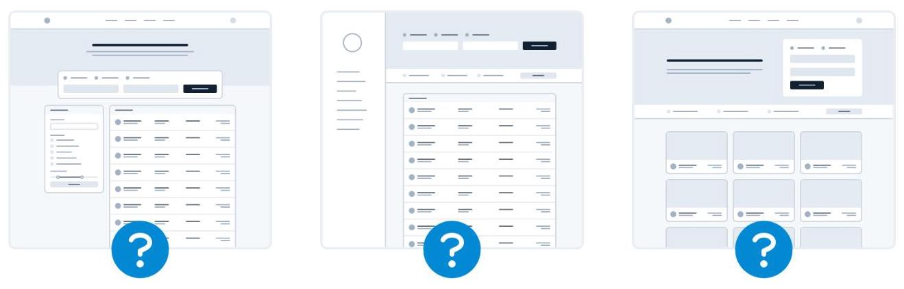
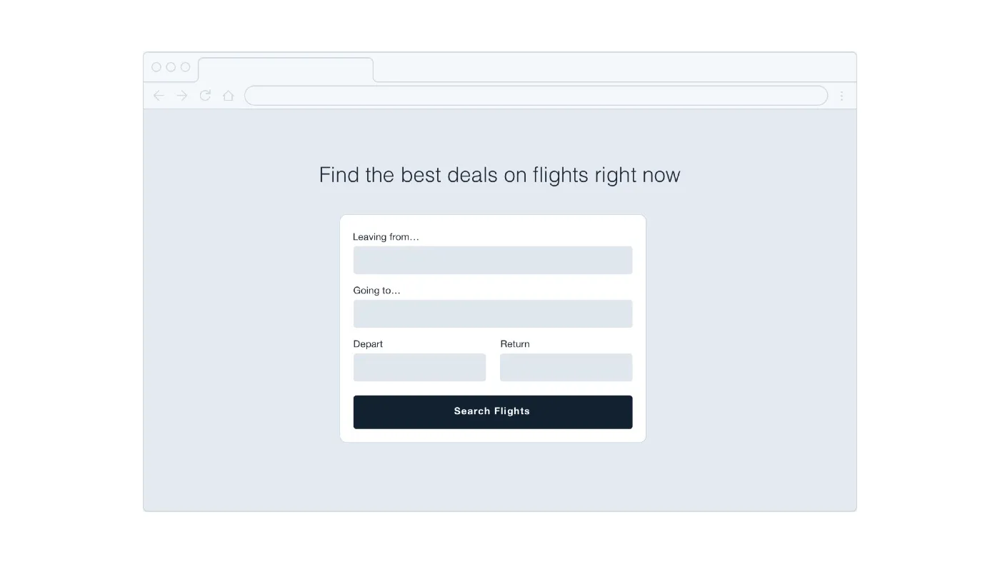
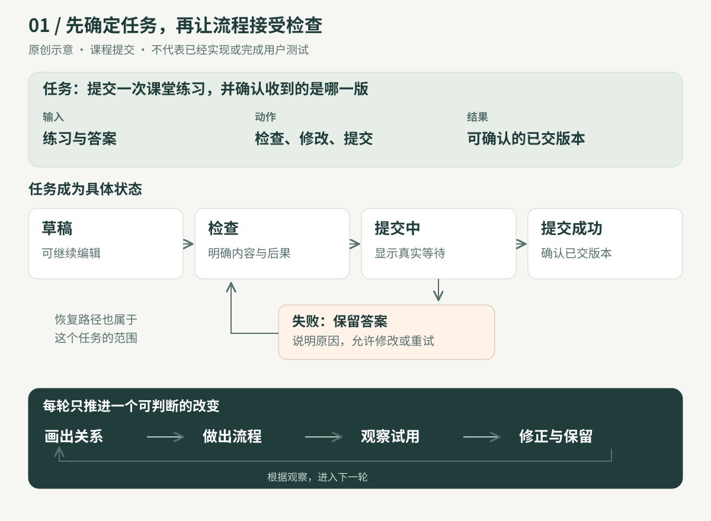
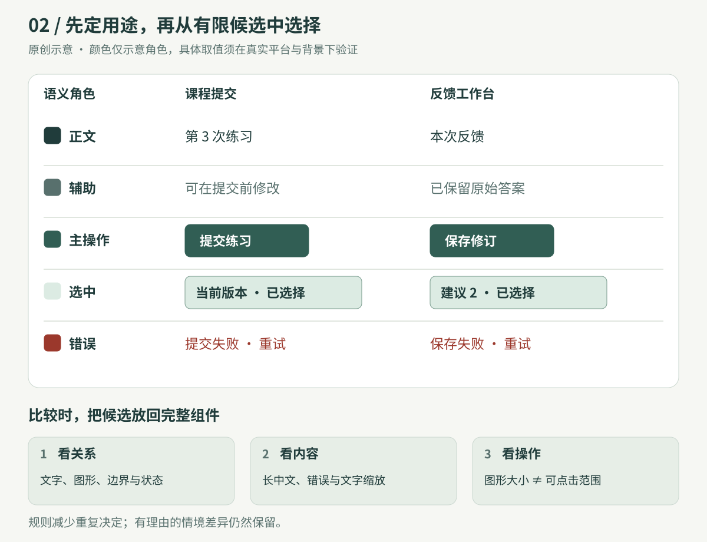
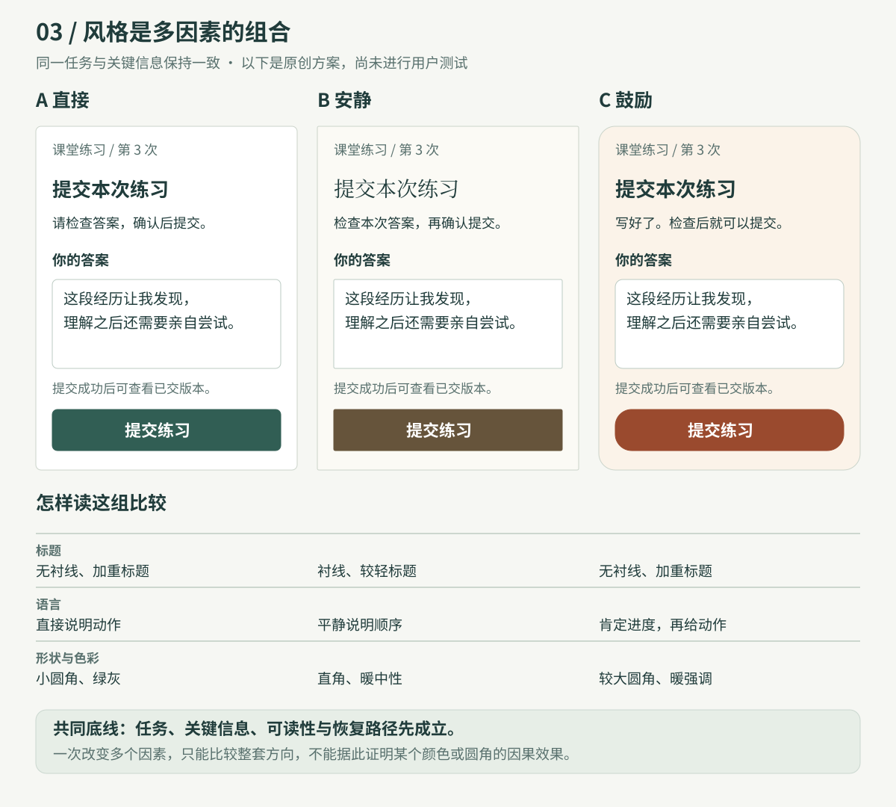

# 01｜先做成一件事，再决定页面长什么样

> **这一章讲什么：** 拿到一个产品想法后，先写清谁要完成什么，再画出行动、结果和失败后的下一步。页面的颜色、间距和形状，随后围绕这个过程选择。
>
> **适用：** 教学工具、工作台、相机或其他需要人完成操作的产品。  
> **你会留下：** 一句话任务、一条可试的流程，以及下一次要检查的问题。

## 先看区别：从页面出发，还是从任务出发？

假设你要做一个课堂作业提交工具。

| 如果先想页面 | 如果先想任务 |
|---|---|
| 左边要不要侧栏？放几张卡片？用什么颜色？ | 学生提交哪份答案？能否修改？老师收到的是哪一版？ |
| 很快能画出一个完整框架，但还不知道里面为什么有这些区域。 | 先确定必要的信息和动作，再决定哪些需要放在页面上。 |

这不是说视觉不重要：**视觉设计需要有明确的任务来服务。** 下面的课程示例用机票搜索展示同一思路：第一张图先选布局，第二张图先围绕搜索功能组织信息。

*来源：[Notion 课程：Start with a feature, not a layout](https://www.notion.so/226886bc60ff81038183c9e2df0070a4)，整理自 [Refactoring UI](https://refactoringui.com/)。原图以机票搜索作例子，展示先明确功能再组织界面。*

## 01 · 写出一句任务

> **学习者写完一段答案，检查内容，然后确认老师收到了哪一版。**

这一句已经带出设计要解决的四件事：

| 环节 | 这一步需要什么 |
|---|---|
| 输入 | 练习题、答案和必要的身份信息 |
| 行动 | 检查、修改、提交 |
| 结果 | 明确展示已提交的版本和真实状态 |
| 恢复 | 提交失败时保留答案，并提供重试路径 |

先把这四项写在纸上，再讨论用什么布局。真实任务需要语音、图片或协作时，它们仍是核心范围，不能为了简化悄悄删掉。

*图：本章用课程提交举例。失败恢复与试用验证是对来源的补充归纳。*

## 02 · 让第一个版本真的能走完

第一版可以只支持一种练习，但要覆盖完整过程：

1. **开始：** 展示当前练习与已有答案。
2. **操作：** 可以检查和修改；交代提交后能否再改。
3. **等待：** 提交过程中显示真实状态，避免重复触发。
4. **结果：** 提交被系统确认接收后，显示已提交的版本。
5. **恢复：** 失败时保留答案，并说明如何重试。

一个按钮只有“提交”的样子、点下去却没有真实结果，还不算完成了提交任务。

*来源：[Notion 课程：Don’t design too much](https://www.notion.so/226886bc60ff8132bb93f7b13fd24284)，整理自 Refactoring UI。图中展示设计与代码的往复；本章提出的实际试用是额外的验证步骤。*

**做完这一轮，再决定下一轮改什么。** 例如，有人以为“已提交”就代表“老师已批改”，优先处理这两个状态的区别；如果大家找不到最近一次提交，再调整结果入口。

## 03 · 给视觉选择安排用途

预先确定少量候选，能减少每次重新挑色、字号和间距的负担。但候选还要有用途：哪种颜色表示主操作？哪种表示错误？辅助说明与正文怎样区分？

将选定的值放回真实组件中检查：文字放大后是否完整？错误是否只靠颜色表达？按钮是否容易点击？原生应用先沿用平台和项目已有的语义角色。

**规则用于减少重复决定，不必强迫所有元素相同。** 按钮、消息气泡与大面板可以属于同一套设计，同时使用不同圆角；字号和间距也随内容、设备与任务调整。

## 04 · 风格是一个组合

字体、颜色、图像、形状、留白和文字语气会一起影响感受。比较风格时，可以让同一任务保持不变，分别试更直接、更安静或更鼓励的表达。

*图：这是三种原创示意，不是已进行用户测试的结论。*

先检查共同底线：任务清楚吗？正文能读吗？错误后知道怎么继续吗？之后再讨论哪一种气质更适合使用者。不要仅凭“教育产品就应该可爱”决定风格。

## 05 · 拿真实任务试一次

这不是本章已经完成的实验，而是一份简单的验证计划：

| 观察什么 | 请对方做什么 | 留下什么 |
|---|---|---|
| 是否理解 | 不解释，先请他说明页面能做什么 | 他自己的话和误解 |
| 是否能完成 | 给一个实际提交任务，观察操作 | 步骤、犹豫、误点及帮助 |
| 出错能否恢复 | 在可控条件下模拟失败 | 答案是否保留、下一步是否清楚 |
| 结果是否明确 | 找出刚提交的内容与状态 | 是否混淆保存、提交、送达和批改 |
| 风格是否合适 | 任务完成后询问感受及原因 | 感受与任务表现分别记录 |

如果这是学习产品，还要另看学习者能否独立完成一道相近新题。**提交成功说明操作完成；是否学会，需要另外观察。**

## 用在你的项目里

- **学习工具：** 学生完成一次练习后，能否看懂反馈，并知道如何再试？
- **相机：** 拍摄、处理、保存分别是什么状态？失败后原片是否还在？
- **工作台：** 用户能否用已有资料完成一个任务、修改结果并找回原版本？

先选一条你最熟悉的过程，写下“输入 → 行动 → 结果 → 恢复”，再挑最不确定的一步验证。

[查看本章完整进阶版：详细案例、反例和来源](deep-dive/01-start-with-a-task.md)

[返回手册目录](README.md)

本章来源和阅读范围

本章根据 Refactoring UI「Starting from Scratch」五个整理页面的文字与原页图像观察整理：Start with a feature, not a layout；Detail comes later；Don’t design too much；Choose a personality；Limit your choices。已观察 28 次图片引用，其中有重复，不能称作 28 个独立案例。本章标注为原创的图是示意，非真实用户测试或上线结果；课程原图按具体页和图注单独注明。未经验证的因果、效果和固定数值不写成普遍结论。

课程原页来源登记与图示登记以主书现有 sources 和 register 文件为准；本章不是整套资料已读完的声明。

