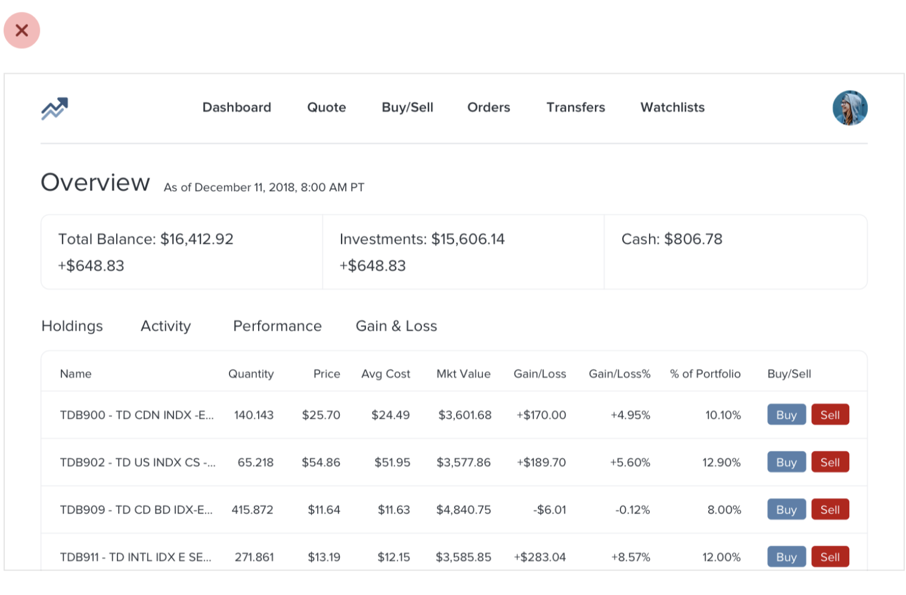
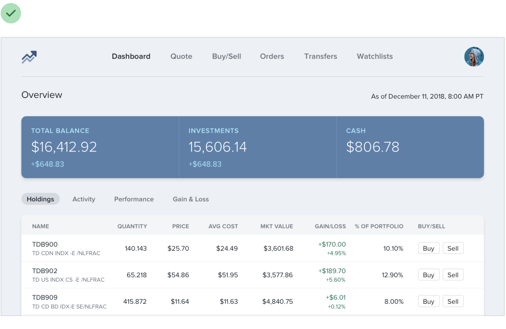

# 02｜信息层级：让人先看到当前要做的事

> **这一章解决什么：** 页面信息很多、按钮都很醒目时，怎样让人找到当前任务，同时不丢掉必要说明？  
> **试一试：** 打开自己的一个页面，标出用户此刻最需要看到、用来判断和偶尔才用的信息。

## 先确定任务，才能决定什么醒目

教师进入讲评工作台，想比较几条回答中的共同问题。对当前任务来说：

| 页面内容 | 此刻的作用 | 设计重点 |
|---|---|---|
| 待比较的回答 | 正在处理的材料 | 读得清，能对应到各自反馈 |
| 课程名和更新时间 | 帮助定位、判断版本 | 容易找到，但不必和答案争抢注意 |
| 移除草稿 | 不常用但需要明确后果的操作 | 可发现，名称清楚，按实际能力说明恢复 |

换成“确认明天上课时间”时，时间便可能成为第一眼要找的信息。**层级来自当前情境，不是信息类别的固定排名。**

下面的课程图与上面的讲评工作台是不同案例，用来观察视觉强调如何改变。

[放大看调整前的原图](../assets/course-examples/ch02-hierarchy-before.png) · [放大看调整后的原图](../assets/course-examples/ch02-hierarchy-after.png)

*来源：[Notion 课程：Not all elements are equal](https://www.notion.so/226886bc60ff8161b76bcbb97a54288c)，整理自 [Refactoring UI](https://refactoringui.com/)。图中多个视觉因素同时变化，不能归因于某一个参数。*

先缩小页面或眯眼观察，数一数同时抢眼的深色块、粗字、边框和按钮，再与当前任务所需的重点对照。有时减轻周边元素，比把主标题继续放大更有效。弱化不等于让导航或返回入口难以辨认。

*原创示意，不是已测试的产品；字号、字重、分组等同时变化。*

## 字号不是唯一的层级工具

保持正文与必要说明可读，再用字重、位置、对齐、颜色或间距区分角色。图标、边框也有视觉重量：一个实心图标可能比文字更抢眼；必要的控件边界则不能为了简洁随意抹掉。

文字和背景要一起检查。网页中，WCAG 的常规文字对比通常至少 4.5:1，大字通常为 3:1；具体适用和例外见 [W3C 的说明](https://www.w3.org/WAI/WCAG22/Understanding/contrast-minimum.html)。重要控件与状态的非文字视觉信息也有[相应要求](https://www.w3.org/WAI/WCAG22/Understanding/non-text-contrast.html)。一项比例通过，仍不代表整个流程无障碍。

照片、纹理和动态取景中的背景会变化。别只在纯色样例上检查覆盖文字，也别假设加一层遮罩就一定清楚。

## 标签要不要突出，看人要找什么

展示进度时，可以突出“3 条回答”，让辅助标签“待讲评”稍安静，同时保留完整含义；查找班级、时间或练习类型时，标签本身可能是扫描入口。保留数字单位、范围和时间条件。

**表单输入仍需要清楚的标签或说明。** 课程对展示数据的讨论，不能推导成删除表单标签；具体可参考 [W3C Labels or Instructions](https://www.w3.org/WAI/WCAG22/Understanding/labels-or-instructions.html)。视觉上变小的标题也应保留正确的结构和阅读顺序。

## 操作的主次和后果，分别判断

“继续准备讲评”可能是当前主要动作；“永久删除草稿”不是主要动作，但仍要讲清删除对象和能否恢复。

1. **先看主次：** 当前步骤最需要推进什么？
2. **再看后果：** 做错会改变什么，是否能恢复？
3. **再定表达：** 用恰当的名称、视觉强调、说明和必要确认。

真实产品若能恢复，就按实际能力写；不要把假设的“永久丢失”照搬。网页中视觉像链接的“删除草稿”如果执行当前页面动作，仍应使用按钮及相应键盘行为；颜色也不应成为辨认状态的唯一线索。

## 用一轮修改来检查

1. 写下页面当前任务，不为制造清爽而先删内容。
2. 标出先发现、辅助判断、偶尔使用的内容。
3. 找到反复争抢注意的深色、粗字和操作。
4. 检查长中文、数字单位、错误状态和实际恢复路径。
5. 请合适的读者找信息并完成一次任务，记录原话与所需帮助。

单次试用能帮助发现问题，不能推出总体改善比例。学习练习还要小心不要把正确答案用视觉层级直接泄露。

[查看本章完整进阶版：包含详细案例、反例与来源登记](deep-dive/02-hierarchy-and-actions.md)

[返回手册目录](README.md)
