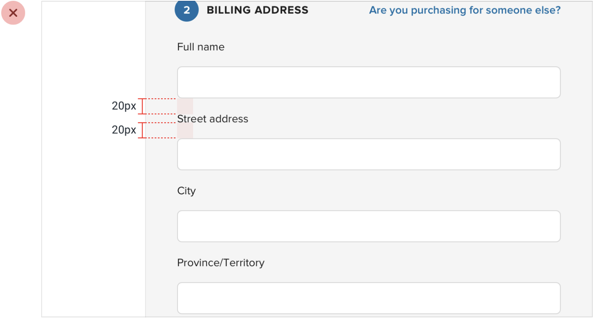
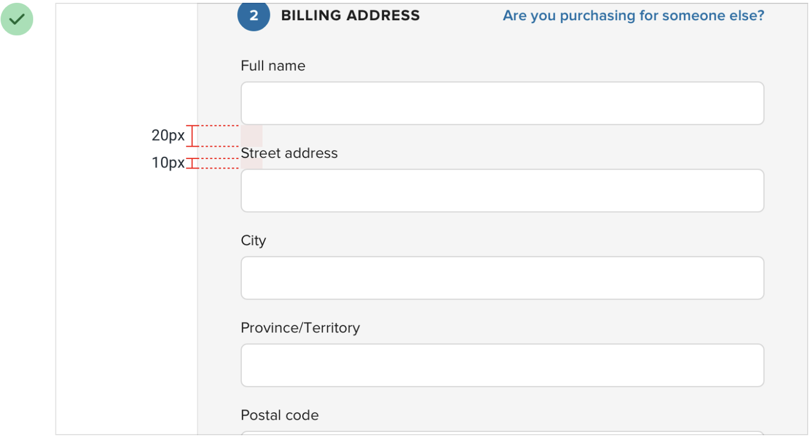
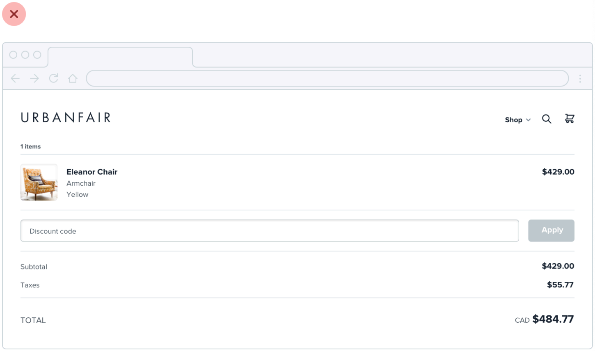
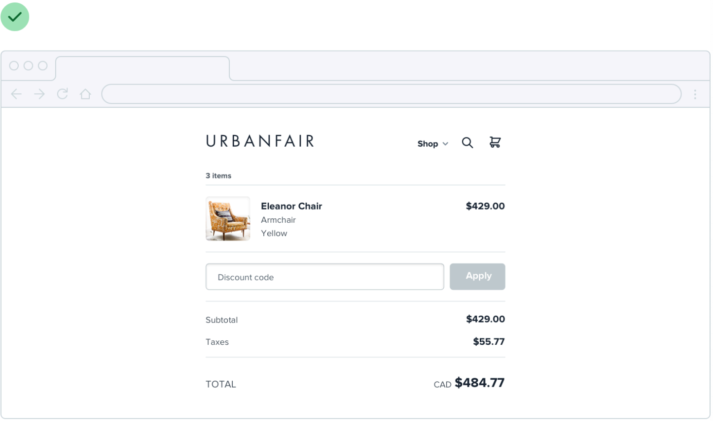

# 03｜布局与间距：让相关内容待在一起

> **这一章解决什么：** 间距不仅是留白多少，它影响人们能否看出标题、说明、答案和反馈之间的关系。  
> **试一试：** 用真实内容检查一个页面：哪些东西要一起看？窗口变窄后关系还清楚吗？

## 先看关系，再决定距离

一个学生需要看原句、理解修改要求、写下答案。可以先分成三组：

- **参照组：** 原句和修改要求。
- **作答组：** 输入标签、答案和对应提示。
- **推进组：** 提交动作和结果说明。

组内相关内容通常需要更靠近；不同组可以通过距离、对齐或分隔区分。重点是能看懂归属，而不是整页统一加大留白。

*这张原创图保持示例文字与面板宽度一致，用间距表达两组关系；它不是实际读者表现的实验。*

[放大看调整前的原图](../assets/course-examples/ch03-spacing.png) · [放大看调整后的原图](../assets/course-examples/ch03-spacing-after.png)

*来源：[Notion 课程：Avoid ambiguous spacing](https://www.notion.so/226886bc60ff8118a0dafdf98c4a9180)，整理自 [Refactoring UI](https://refactoringui.com/)。关注字段标签与所属输入框、不同字段之间的距离，不将图中具体数值当成固定规则。*

长说明换行后，续行应仍属于同一项。相邻的“保存”和“放弃”虽然都与编辑有关，也要保留清楚区分和足够操作空间。

## 调密度时，分别看五种空间

| 空间 | 主要问题 |
|---|---|
| 导航宽度或高度 | 是否真的需要持续切换？窄屏还剩多少任务空间？ |
| 主内容到边缘 | 长文本能否舒服地阅读和换行？ |
| 不同区块之间 | 不同任务能否分辨，又不会把需要对照的内容推太远？ |
| 同组组件之间 | 标签、输入和反馈是否仍能看出关系？ |
| 组件内部 | 内容与边框是否拥挤？按钮和文字是否被挤压？ |

图中的导航是为了说明角色而设置的例子。一个独立练习可能只需要返回入口和当前位置。

教师比较多条答案时，可能需要同屏看见更多内容；学生写长答案时，可能更需要空间和贴近的提示。**密度由任务决定，宽松与紧凑都要有具体理由。**

[放大看宽屏原图](../assets/course-examples/ch03-width-before.png) · [放大看调整宽度后的原图](../assets/course-examples/ch03-width-after.png)

*来源：[Notion 课程：You don’t have to fill the whole screen](https://www.notion.so/226886bc60ff819db46cf4740e7a5632)，整理自 Refactoring UI。两图对比内容宽度，但商品数量文字也不相同，并非只改变宽度的受控对比；具体宽度要按内容和任务检查。*

## 宽屏和窄屏，保持任务关系

窗口变宽，不代表所有内容都要跟着无限变宽；窗口变窄，也不应该把桌面整体等比例缩小。

| 区域 | 可以怎样变化 |
|---|---|
| 题号、简短状态 | 相对稳定，但文字放大或语言变化时重新检查 |
| 输入与答案 | 随空间伸缩，保留足够的可用宽度 |
| 长段阅读 | 设置适宜上限，避免行过长 |
| 参照与作答 | 空间足够时并排，不足时按原有关系上下排列 |

图示展示重排思路，并不证明真实产品的焦点顺序、输入法、滚动和保存行为已经通过检查。

网格是实现工具，可以组合固定、伸缩和内容约束。关键是先想好各区域怎样变化，而不是把所有内容机械分配成固定比例；具体能力见 [W3C CSS Grid 轨道尺寸](https://www.w3.org/TR/css-grid-1/#track-sizing)。

## 一次实际调整

1. **固定真实内容：** 放入完整的原句、要求、答案和状态。
2. **检查归属：** 每条反馈能否认出对应哪一条答案？
3. **调整五类空间：** 先精调一个代表页面中关系不清和操作拥挤处，再按用途整理反复使用的间距；有理由的例外保留理由。
4. **换屏幕检查：** 窄窗口、长中文、多行输入和文字放大都试一遍。
5. **走完整任务：** 输入、修改、提交、失败恢复和返回；记录实际卡点。

如果练习要学生独立补出原因，就不能为了让界面看起来顺畅，直接把答案替他填好。操作容易与真正学会是两个需要分别观察的问题。

[查看本章完整进阶版：包含更多案例、适配与验证细节](deep-dive/03-space-and-density.md)

[返回手册目录](README.md)
