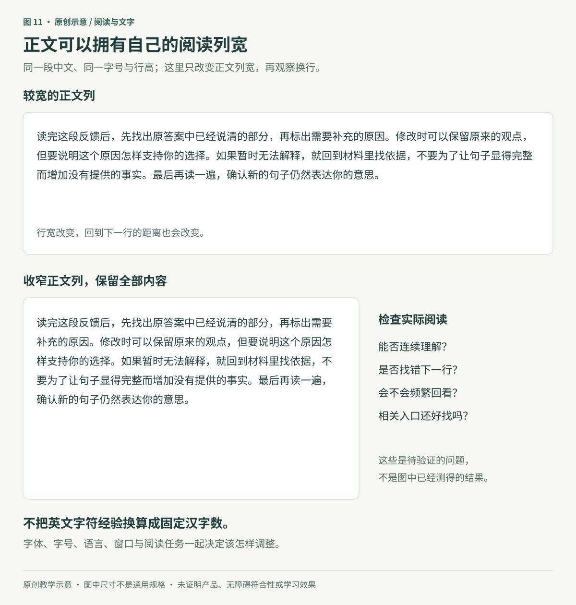
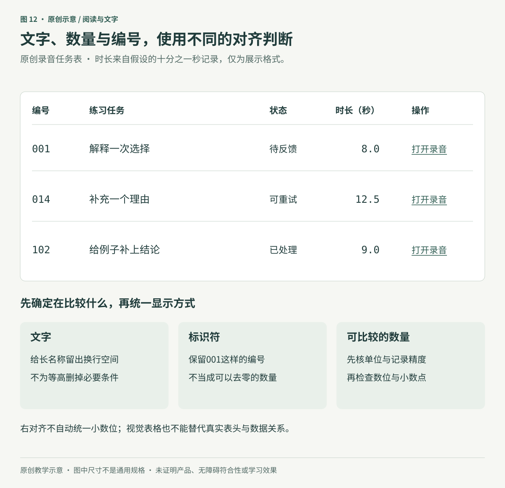

# 为阅读设计文字：让人读懂、找到并继续

**原创专题初稿。** 本章完整读取了资料库中 Refactoring UI「Designing Text」八个整理页面的导出正文，并使用主审读者在原生 Notion 页面中留下的40次图片引用观察记录。本文作者没有亲自重新查看原图片；页面上下文观看完成不等于素材URL和文件哈希已经核验。图10–12为匿名课程与工作台的新示意，不能作为真实学习记录、产品实现或试用效果的证据。

学习者打开反馈，需要读懂一句解释、找到原答案，再决定如何修改。教师打开同一课程的任务列表，可能更关心哪段录音尚未处理。两人看到的都是文字，但需要完成的阅读动作不同：连续理解、快速定位，以及辨认可以执行的动作。

本章从这些动作决定文字角色、阅读列宽与对齐方式。它与[信息层级](02-hierarchy-and-actions.md)、[布局与密度](03-space-and-density.md)配合使用，不要求先建立一套庞大的字体规格表。

## 1. 先确定文字要做什么

“字号统一”不等于所有文字一样大。更有用的一致性是：承担相近职责的文字，使用可预测的样式；职责变化时，有理由地改变强调。

例如，一次练习反馈可以这样安排：

| 角色 | 本章原创示例 | 首先要解决的问题 |
|---|---|---|
| 定位 | 练习2：解释一个选择 | 能否知道自己正在看什么 |
| 主要阅读 | 原因已经写出，但还需要说明它与选择的关系 | 能否连续读懂，不被装饰或拥挤打断 |
| 当前行动 | 修改这一句 | 能否预测动作及其对象 |
| 相关入口 | 查看原答案 | 不抢正文的注意，也能被发现 |
| 状态 | 草稿已保存 | 含义准确、看得清楚，不与提交结果混淆 |

图10没有把每种角色都变成一种新字号。字重、位置、分组、文字本身和操作形式可以共同表达关系。必要的状态与说明不能仅因“次要”就被缩小到难读；对比要求参见第二篇。

可以从一个代表页面里提取实际需要的少量样式，再用于相近页面。若已有认可的项目字体与组件，先沿用并检查问题，不必因为看到一套数学阶梯就重设全部字号。

### 字体候选要放进真实文本

字体的字重数量、热门程度或出现在知名网站上，都不能直接证明它适合这个任务。五种字重不是质量门槛，拥有很多样式也不表示需要全部加载。

比较候选时，放入真实中文、标点、英文、数字和会出现的符号。例如检查“练习12：解释与例证”“because / however”“001”和“12.5秒”：有没有缺字，中文与英文是否显得互不协调，正常字号下笔画是否拥挤，粗体与常规体能否承担清楚的角色。字体替换或尚未加载时，内容也应继续可读。

拉丁字母的小写高度可以帮助观察某些字体，但不能代替汉字字面与笔画的检查。正文、标题和紧凑表格的任务也不同；不要仅靠增加字间距来补救不适合小字号阅读的字形。将实际选用字体的来源、语言覆盖与使用许可一并记录，比保留“高级字体”这样的评价更可复用。

给候选字体做两轮试排：先在同一份练习标题、完整反馈段落和作答表单中，固定内容、容器宽度、颜色、字号与行高，仅替换候选字体，记录字面大小、换行位置、标签占宽和强调是否清楚。同一字号不保证看起来同样大，这一轮用于发现差异，不据此选出“最好”的字体。第二轮再按各自字形调整字号、行高与字重，并记下变化；此时比较的是整套排版方案，不能把所有差异都归因于字体。最后用真实中文、数字和符号，在目标设备、窄窗口及字体未加载或回退的条件下检查；标题好看，不能替代长段阅读和表单查找。保留必要内容，不能靠裁掉末行或缩短标签让候选显得整齐。

## 2. 阅读列宽与行高要一起调整

一行很长时，读者需要跨越较远距离回到下一行；列过窄时，又会频繁换行，词语和句意可能被切得零碎。能容纳多少字只是观察线索，不能脱离字体、字号、语言、阅读任务和窗口来决定。

来源中的45–75字符建议来自英文示例，不能改写成“每行45–75个汉字”。同样，若用相对字体单位表达宽度，也不能把单位数当作所有文字系统下准确的字符数。

图11只改变示例正文列宽，并按宽度重新换行；旁边说明文字不属于反馈正文。两种样式都保留完整内容。这不是读者实验，也没有宣称某个行数已经最佳。真正需要判断的是：读者能否连续读懂，是否反复找错行，是否还看得见与当前阅读有关的操作。

正文可以拥有自己的宽度上限，图表、示例对照或任务列表则按各自用途布局。没有必要为了限制阅读行长，把整页所有对象强行收成同一宽度。

行高也要与实际字形一起看。它不等于两个字形之间的净空；中英混排、上下伸出的笔画、重音符号和不同字体都可能改变一行的视觉表现。大标题可以更紧凑，但多行标题仍不能挤到碰撞；正文需要清楚的行与段落关系，但加大行高也可能让一句话显得散开。

本章不采用“最小1倍、最大2倍”的固定范围。遇到回行困难，先同时检查列宽、字号、字体和行高，而不是只把行高继续加大。

### 保留用户调整间距的空间

WCAG 2.2 的文字间距要求，针对支持相关样式属性的标记内容，检查用户在不改变其他样式属性的情况下，同时将行高设为至少字号的1.5倍、段后间距设为至少2倍、字母间距设为至少0.12倍、词间距设为至少0.16倍时，内容和功能是否仍保留。某种语言或文字系统不使用其中某属性时，只需适用的属性。这些数值是适应用户设置的检查条件，**不是默认排版必须全部采用的数值**，也不要求一定新增一套字号或间距设置面板。[W3C：Text Spacing](https://www.w3.org/WAI/WCAG22/Understanding/text-spacing.html)

> Content is not required to use these text spacing values.

—— W3C 无障碍指南工作组，[《WCAG 2.2》1.4.12，注 1](https://www.w3.org/TR/2024/REC-WCAG22-20241212/#text-spacing)，2024-12-12 推荐标准版。

**本章译：** 内容不必采用这些文字间距值。

这是规范中的说明性注释，澄清默认样式与用户覆盖的区别；它不免除在上述适用条件下保全内容和功能的要求，也不能直接变成纸张排版或原生应用的通则。

因此，固定高度的文本框、按钮或提示需要特别检查。若文字间距变化后最后一行被裁掉，不能通过禁止用户调整来维持原图的整齐。

## 3. 对齐方式取决于内容类型

横排中文与英文的长段落通常可以先采用稳定的左侧起点，再观察实际阅读。短标题、单句提示或需要对称构图的内容可以尝试居中，不必把它当作禁区。关键在于整段是否容易跟读，而非只看单行是否“在正中”。

如果几个说明长度不一，不要为了让卡片等高而删掉必要条件。可以改写冗余表达、调整布局，或接受不同高度；事实与操作要求应先得到保留。其他书写方向需要相应的阅读起点，不能把左对齐写成所有语言的规则。

并排的大小文字可以检查基线，而不是只对齐各自外框的中心。基线不是所有字形的最底边；下伸笔画会越过它。基线对齐适合某些同一行的文字关系，不要求头像、图标、多行标签和按钮一律照做。中英混排或不同字体仍应实际查看。

图12中的三条任务和时长都是演示数据。表格采取了不同规则：

- 任务名称与状态从稳定的起点阅读，长名称可以换行。
- 编号“001”是标识符，不是数量，不应为了数值格式丢掉前导零。
- 时长使用同一单位与已有的十分之一秒精度，并采用等宽数字。此时右对齐可以让小数位便于比较。
- “打开录音”始终有可见的文字与下划线，不能只在鼠标经过时才让人知道它是入口。

右对齐本身不会让不同精度、不同单位或不同后缀的数字自动对齐小数点。展示“8”“12.50”“9秒”前，应先决定它们是否本来就在比较同一种量；不能为排得整齐，补出数据源没有的精度。必要时统一有依据的显示格式，或采用明确的小数点对齐方式。

实际网页表格还应表达表头与单元格的关系。对齐和颜色只提供视觉线索，不能替代程序可确定的结构；对于真正的表格，应按需要提供正确的表头关联，而不是只画几列文本。[W3C：Info and Relationships](https://www.w3.org/WAI/WCAG22/Understanding/info-and-relationships.html)

## 4. 链接安静，也要让人找到

长段落中的链接与连续内容混在一起，需要让读者辨认它是一个入口。大量链接组成的列表，可以通过稳定结构、明确名称与适度层级减少视觉竞争，但不能把可发现性完全推迟到鼠标悬停。

本章采用的做法是：正文入口保留明确的非颜色提示，例如下划线；列表入口根据结构表达可操作性，同时检查触屏、键盘焦点和实际跳转。这里的常显下划线是本章的设计选择，不是WCAG要求所有链接采用的唯一样式。其1.4.1关注是否只靠颜色表达信息；官方技术G183也认可行内链接与周围静态文字至少3:1的明度差作为一种区分方式，文字对背景的对比仍需另查。[W3C：G183](https://www.w3.org/WAI/WCAG22/Techniques/general/G183) 键盘可操作与可见焦点则需要在实现中分别核验，不能由下划线存在推定通过。[W3C：Use of Color](https://www.w3.org/WAI/WCAG22/Understanding/use-of-color.html)、[Keyboard](https://www.w3.org/WAI/WCAG22/Understanding/keyboard.html)、[Focus Visible](https://www.w3.org/WAI/WCAG22/Understanding/focus-visible.html)

只改变下划线或颜色，与出现额外说明是不同情况。若悬停或焦点会弹出补充内容，应再检查WCAG对可关闭、指针可移入、内容保持显示的适用要求及例外；不能让读者一移动指针，正在读的说明就消失。这里不要求每个链接都增加提示框。[W3C：Content on Hover or Focus](https://www.w3.org/WAI/WCAG22/Understanding/content-on-hover-or-focus.html)

## 5. 把单位和字间距当作有上下文的工具

`em`并非不能使用。它用于字号时，相对于继承的字号计算；用于常见的宽度或内边距时，依据元素自己的计算字号。`rem`则与根元素字号相关。层层设置字号倍数会产生累积，因此要知道基准在哪里；有意让局部间距随文字变化，也可以是合理用途。[W3C：Font-relative Lengths](https://www.w3.org/TR/css-values-4/#font-relative-lengths)

实际项目可以把正文、标签、标题等角色映射到已有样式变量，减少无意的嵌套变化。选用某一种单位不自动保证可访问性，也不能以“严格符合字号阶梯”为由锁住用户放大。小数值本身也不等于排版错误，仍要看实际计算与渲染结果。

字间距则从字体默认表现开始判断。某个英文标题收紧后更合适，不表示中文标题也应该机械采用负字距；全大写拉丁字母的示例也不能推出所有导航都应大写或加宽。先看真实字形、笔画是否相碰、标点与中英混排关系，再决定是否局部改变。

两端对齐也应按语言检查。英文断字可以处理部分长词，但不能替代中文的标点与换行处理。不要为了“正式”而接受明显大空隙、难辨的词语或不合适的标点位置。

## 6. 用一次真实阅读任务检查

本章的原创情境是：学习者读一段反馈，指出需要修改的地方，打开原答案，完成修改并确认草稿状态。教师随后在任务列表中找出指定编号的录音。以下步骤是验证计划，尚未得到真人结果。

1. **准备完整材料。** 使用真实长度的反馈、长中文任务名、英文术语、编号和状态；保留必要条件，不以占位短句替代。
2. **选一页作为基线。** 先分配定位、正文、入口和状态角色，再调整阅读列宽与行高；一次改变后记录具体原因。
3. **实际朗读或复述。** 观察读者能否说出反馈要求，而不是只问“字体好不好看”。记录原话、回看与误解，不把一次观察推成总体成功率。
4. **走查找与操作。** 从任务描述开始，不提示点击位置。检查链接能否发现，编号和时长是否被理解，焦点与返回位置是否可继续。
5. **改变条件再查。** 换窄窗口、放大文字、调整适用间距，检查换行、裁切、溢出、操作和状态是否完整。

网页的相关基线包括：文字可放大到200%而不丢失内容或功能（该条另有字幕和文字图像例外）；纵向阅读内容在相当于320 CSS像素宽的条件下重排，并保留内容和功能、避免双向滚动，确实需要二维布局的部分另有例外。这些是CSS视口与适应性要求，不能用手机物理像素代替，也不能仅凭一张窄版图宣称通过。[W3C：Resize Text](https://www.w3.org/WAI/WCAG22/Understanding/resize-text.html)、[Reflow](https://www.w3.org/WAI/WCAG22/Understanding/reflow.html)

表格需要二维关系，并不意味着所有单元格里的长文字都可以不用重排。原生应用则另查实际支持平台的文字设置、输入方式与设备表现；网页的CSS条件不能机械变成原生字号规格。

读懂反馈和顺利点击仍不能证明学会。若教学目标是写出有依据的原因，还需观察学习者在新的材料中能否独立完成，区分首答、提示后修改与迁移表现。文字设计减少界面造成的困难，应当保留教学任务本身需要的思考。

## 来源与检查范围

八个整理页对应的原作目录，已由来源核验者对照Refactoring UI官网确认；原书PDF、版本差异和素材身份没有逐一核验。主审读者完成40次原页图片引用观察，本文作者只使用其书面记录，不将重复引用计作独立研究证据。原作归属见[共同来源记录](../sources/refactoring-ui.json)。

| 来源ID | 整理页标题 | 本章采用与修正 | 图像观察 |
|---|---|---|---:|
| RUI-TEXT-01 | Establish a type scale | 用角色组织有限样式；小数与em不自动错误，继承上下文应明确 | 5次 |
| RUI-TEXT-02 | Use good fonts | 实际字形与任务检验优先；字重数量、热门程度不保证质量，截图站点身份未确认 | 5次 |
| RUI-TEXT-03 | Keep your line length in check | 正文独立限宽；英文字符经验不直接换成汉字数量 | 5次 |
| RUI-TEXT-04 | Baseline, not center | 适用于部分并排文字；基线不等于所有字形最底边 | 4次 |
| RUI-TEXT-05 | Line-height is proportional | 结合列宽、字形与任务；1–2不作为普适范围，用户设置另查 | 5次 |
| RUI-TEXT-06 | Not every link needs a color | 减少竞争但保留可发现性；不只依赖悬停，静态列表截图不算视频观看 | 4次 |
| RUI-TEXT-07 | Align with readability in mind | 文本、数量和标识符分别判断；右对齐不自动统一精度，英文断字不替代中文换行 | 7次 |
| RUI-TEXT-08 | Use letter-spacing effectively | 局部字形实验；不把英文负字距或全大写做法推广为中文规则 | 5次 |

本章的角色表、匿名任务、图示与验证流程为原创组织。W3C链接只支持本文点名的技术边界，不代表完整无障碍审计或全部规范已读。三张图均已本地实际渲染并检查中文、边界和图文关系，也已完成独立复核；这不等于示例的交互或无障碍符合性已验证。图示检查范围另见[图示登记](../assets/diagrams/register.json)；来源与版本记录见[本章登记](../sources/text-for-reading.json)。本章不增加未读图片、视频或附件的完成状态。
