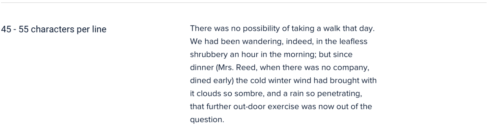
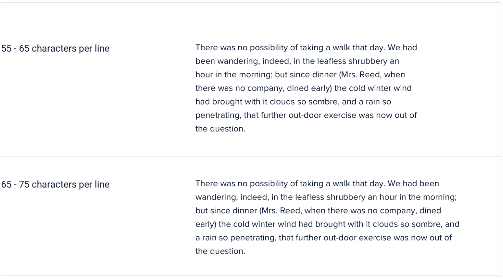

# 04｜让文字更容易读懂

**先判断阅读任务，再调整字形、宽度和层次。** 反馈正文要方便连续阅读，操作入口要能被发现，状态要准确说明发生了什么。

[返回目录](README.md) · [阅读本章完整详解](deep-dive/04-text-for-reading.md)

## 先看图：同一段文字，不同阅读列宽

[放大看 45–55 字符列宽](../assets/course-ref-ui/reading-width-45-55.png) · [放大看 55–75 字符列宽](../assets/course-ref-ui/reading-width-55-75.png)

*图源：Will’s S Design Note 课程中整理的 Refactoring UI，[控制文本行长](https://www.notion.so/226886bc60ff819380c8dbb868cda8ed)。图中文字是英文；图中字符数是示例，不能换成中文每行字数标准。*

列过宽，回到下一行需要跨越较远距离；过窄则频繁换行。**把真实中文段落放进去试读：** 先选清晰的正文样式，再分别在宽屏和手机宽度下读几行，观察回行是否容易、是否频繁换行；逐项调整阅读区域宽度、字号和行高后再比较。正文可以限宽，表格和图片则按内容另做安排。

## 用途不同，文字的样子可以不同

例如一份英语练习反馈：

- **定位**：「练习 2 · 表达原因」告诉人现在在哪里。
- **正文**：清楚解释哪里需要补充，让人能连续读完。
- **行动**：「修改这一句」说清要做什么、改哪一句。
- **状态**：「草稿已保存」说明发生了什么；它不等于已经提交。

先区分这四件事，再决定字号、字重和间距。同类文字应有可预测的样式；次要文字也要看得清。

## 四个马上能做的检查

1. **用真实内容试排。** 放入长中文、英文、数字与标点；不要只用短占位词。
2. **检查链接。** 让正文里的入口平时也能辨认，不只在鼠标悬停时出现。
3. **检查数字。** 编号如「001」保留前导零；比较数值前先确认单位一致，再视情况对齐小数点，不凭空增加小数位。
4. **放大、换窄屏再读。** 按钮、提示、表格里的内容不应因文字变大或换行而消失。对适用网页，还应检查 [WCAG 文字间距](https://www.w3.org/WAI/WCAG22/Understanding/text-spacing.html)与[重排](https://www.w3.org/WAI/WCAG22/Understanding/reflow.html)要求；规范中的用户调整条件不是统一默认排版值。

试着让一位读者说出“这段反馈要求我下一步做什么”。复述可以检查眼前的理解，不能单独证明长期学会。

> 想看字体比较、对齐、链接、用户设置和规范边界？[打开完整详解](deep-dive/04-text-for-reading.md)。详解保留了原有分析、图示和来源，便于查阅。
