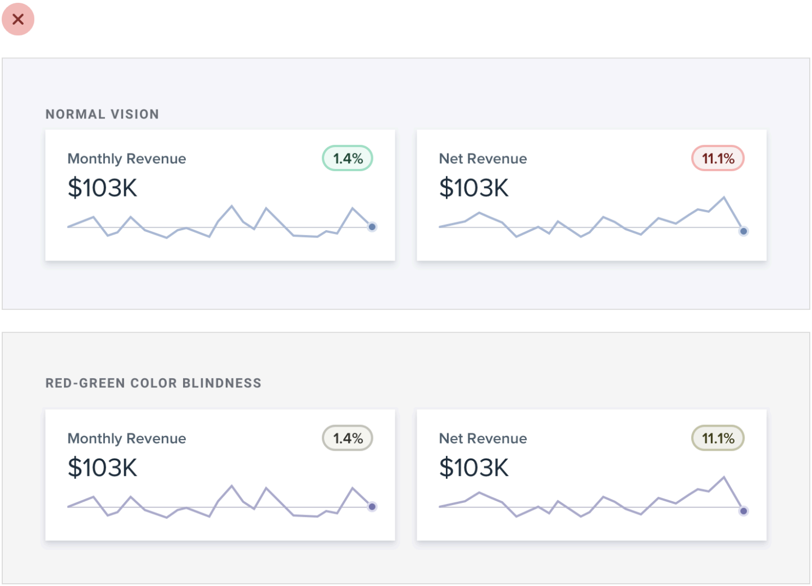
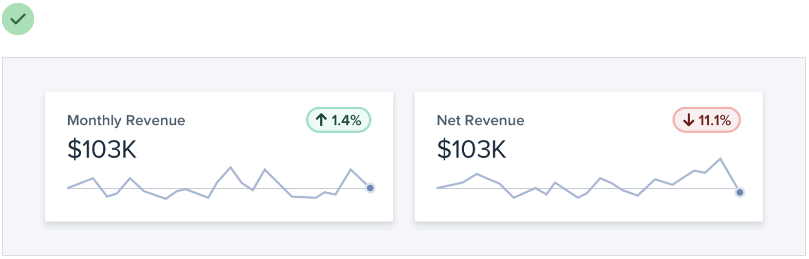

# 05｜颜色要让状态更清楚

**先说清状态，再为它选颜色。** 绿色圆点可能表示已保存、已提交或答案正确；它本身无法告诉人具体发生了什么。

[返回目录](README.md) · [阅读本章完整详解](deep-dive/05-color-and-state.md)

## 先看图：当红绿不再容易区分

[放大看颜色图表](../assets/course-ref-ui/color-only-chart.png) · [放大看加入箭头的图表](../assets/course-ref-ui/color-and-direction.png)

*图源：Will’s S Design Note 课程中整理的 Refactoring UI，[不要仅仅依赖颜色](https://www.notion.so/226886bc60ff8158b4a5e17a99089c8d)。色觉模拟只是帮助观察的一种示意，不能代替完整的无障碍测试。*

第二张图增加箭头，使方向不只靠颜色区分。真实产品中还要确认箭头、文字、读屏说明与数据含义一致；图里的收益数据只是示例。

## 先给每种颜色安排工作

先列出实际需要表达的内容，再安排前景和背景：

| 情境 | 让人知道什么 | 除颜色外，还要检查 |
|---|---|---|
| 保存草稿 | 内容保存在何处 | 明确文字；不要写成已提交 |
| 提交成功 | 结果已被接收 | 内容是否真的提交，下一步是什么 |
| 提交失败 | 哪一步失败 | 原内容是否保留，怎样重试 |
| 当前选择 | 哪个选项生效 | 文字、符号或边界是否共同说明 |

例如，可以先为“提交失败”选一个与当前背景对比足够的错误色，同时显示“提交失败，请重试”和错误图标；再检查该颜色在深浅主题和不同背景下是否可辨认。其他状态也先明确文字和角色，再在真实页面调整和复用。切换深色主题时，重新检查正文、背景与边界的角色配对，不必把整页颜色简单反相。不预设必须使用多少种颜色或色阶。

## 看得见，也要看得懂

- 文字、背景与必要的控件边界都应分别检查对比；图片或半透明背景需要看实际渲染结果。
- 对适用网页，WCAG 2.2 AA 一般要求普通文字至少 **4.5:1**、大字至少 **3:1**；识别控件和状态所必需的视觉信息通常至少 **3:1**，各有条款例外。大字的定义有具体条件，请按链接核对字号和粗细。[W3C：文字对比](https://www.w3.org/WAI/WCAG22/Understanding/contrast-minimum.html) · [非文字对比](https://www.w3.org/WAI/WCAG22/Understanding/non-text-contrast.html)
- 数值通过不代表一整页自动无障碍。还要检查真实主题、缩放、焦点、操作及读者是否理解状态。

**试一次：** 把某个提交界面的截图转为灰度，只看文字与图标，能否分清“草稿已保存”“提交中”“提交失败”？再核对实际功能是否确实到了那个状态。

> 需要色阶、对比计算、亮度与完整规范边界？[打开完整详解](deep-dive/05-color-and-state.md)。
