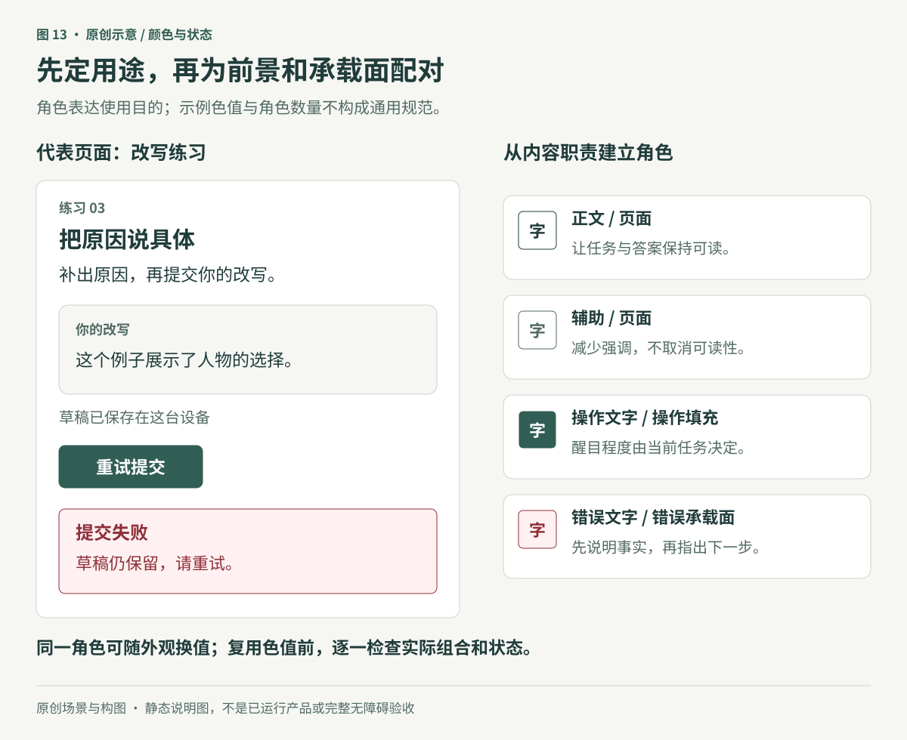
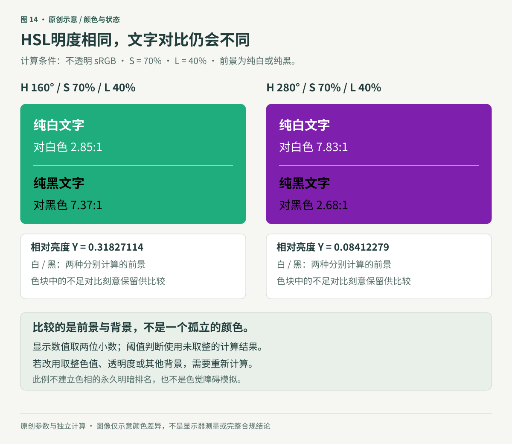
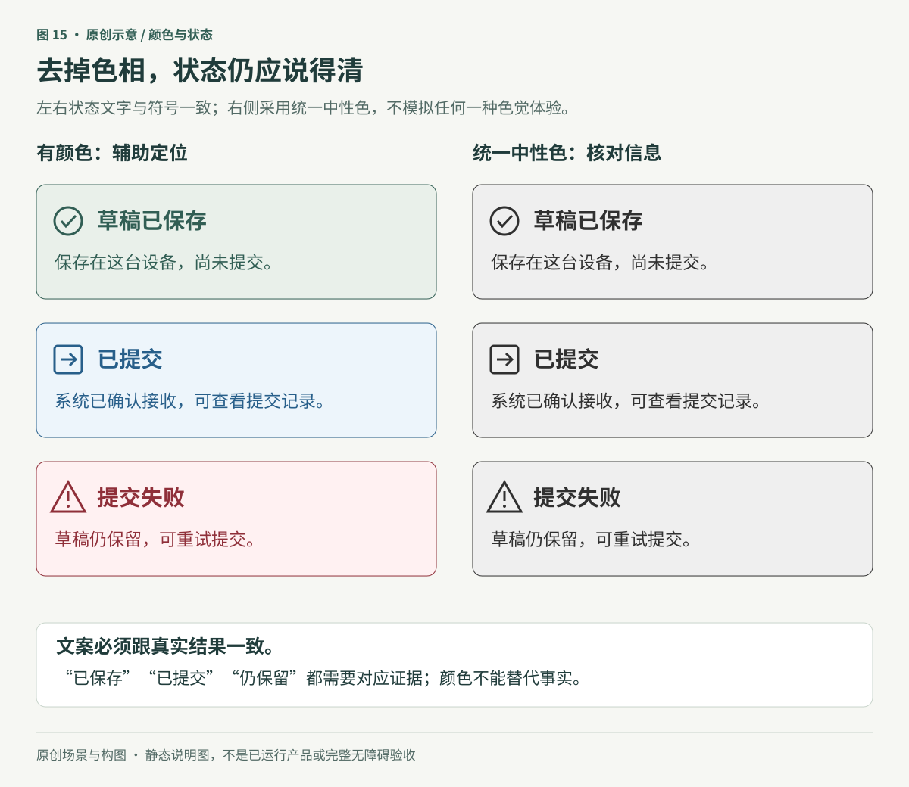

# 颜色与状态：先说明用途，再决定色值

**原创专题初稿。** 本章完整读取了资料库中 Refactoring UI「Working with Color」七个整理页面的导出正文，并采用主审读者对对应原生 Notion 页面所做的50次图片引用观察记录。本文作者没有独立重看源图；素材URL与文件哈希身份尚未逐一核验。三张配图是新编的匿名练习提交场景，不复刻课程原图，也不是已运行的产品或研究结果。涉及技术阈值的部分另核官方资料。

一个学习者写完改写练习，看到一枚绿色圆点。他并不知道它表示“内容已保存在这台设备”“已经交给老师”，还是“答案正确”。颜色有了，状态却没有说明。

本章围绕一个可落实的顺序展开：**先写清用途和状态，再建立可复用的颜色角色，最后检查它们在真实背景、外观和操作状态中的表现。** 页面需要多少种颜色，取决于这些职责，而不是先买一套五色色板，再把所有区域填满。

## 1. 给颜色一个职责，也给它一个搭配对象

先在代表页面上标出必要内容：任务标题、正文、辅助说明、当前选择、主要动作和提交结果。给这些职责取名，再决定它们如何呈现。角色可以共用色值；同一个角色也可能随主题使用不同色值。

本例的“提交练习”需要明显但不压过答案；保存说明需要可读但不抢占提交结果；错误说明需要解释问题和恢复路径。可以组织为以下配对，而不是只留下几个孤立的色块：

| 需要表达的内容 | 颜色角色示例 | 一起检查 |
|---|---|---|
| 主要阅读内容 | 正文前景 / 页面承载面 | 字体、实际背景和长段阅读 |
| 辅助信息 | 辅助前景 / 所在承载面 | 降低强调后仍能看清 |
| 主要动作 | 操作前景 / 操作填充 | 文字、边界、焦点与停用状态 |
| 当前选择 | 选中前景 / 选中背景 | 是否还用文字、形状或位置表达选择 |
| 提交失败 | 错误前景 / 错误背景 | 原因、内容是否保留和下一步 |

这些是本例的工作名称，不是通用令牌数量，也不是特定组件库的API。导航、日历、图表或摄影工具会出现不同职责。一个色值同时承担几个职责时，应检查每个组合；给它起了语义名称，并不能保证所有用法都合适。

图13用匿名练习页面说明角色，具体颜色只服务这个例子。它没有展示全部交互状态，也不要求每个页面拥有这些模块。颜色系统应从已认可的代表页面中整理，允许有理由的变化；不要为了凑齐色阶，把尚无用途的颜色塞进界面。

### 有限选择可以生成，也可以手调

预先整理候选色，可以减少每次随意添加近似色。但课程里的九级色阶、十种灰、固定的100—900编号，以及“不用CSS自动调整”的说法，都不应变成硬规则。生成工具可以提出候选；设计者仍需决定每个候选的用途，并在实际组合中验收。手工调色同样不保证可读。

可以先确定正文与背景、动作前景与填充等关键组合，再补充反复出现的状态和承载面。新增一档颜色时写清它解决了哪一个问题；若只是“这一处想再浅一点”，先查已有角色是否已经适用。

## 2. 分清调色坐标、视觉感受和对比计算

HSL让色相、饱和度、明度参数更容易辨认，适合某些调色工作。它并不要求项目放弃十六进制或RGB。CSS还定义了`hwb()`、`lab()`、`lch()`、`oklab()`、`oklch()`和`color()`等表示；是否用于项目，需要看目标环境和回退。这里核验的是CSS规范内容，没有逐浏览器测试所有能力。[W3C：CSS Color 4](https://www.w3.org/TR/css-color-4/#color-type)

有三个量容易被混为一谈：

- **HSL的L：** 一个颜色坐标。它不是跨色相均匀的视觉亮暗标尺。
- **感知明度：** 人对亮暗的感受；不同模型只能在相应条件下描述它。
- **WCAG相对亮度：** 根据规定的颜色转换计算出的量，用于后续对比计算。

CSS Color 4明确讨论了HSL的感知不均匀性。换成Oklab/OkLCh可以改善调色组织，但不因此替换WCAG 2.2的对比计算。[W3C：HSL及其限制](https://www.w3.org/TR/css-color-4/#the-hsl-notation)

### 同一个L，放白字的结果可以不同

图14使用两个原创选色：`hsl(160 70% 40%)`与`hsl(280 70% 40%)`。两者的S和L相同，只改变H；颜色均不透明，按sRGB计算，前景是纯白或纯黑。

计算结果分别为：

| 颜色 | 相对亮度Y | 对纯白 | 对纯黑 |
|---|---:|---:|---:|
| H160 / S70% / L40% | 0.31827114 | 2.85116014:1 | 7.36542284:1 |
| H280 / S70% / L40% | 0.08412279 | 7.82864742:1 | 2.68245571:1 |

表中计算先从HSL得到未取整的sRGB通道，再按WCAG定义线性化；图中数字仅为展示而取两位小数，判断不靠四舍五入跨过阈值。如果实现时改成取整后的十六进制颜色，应重新计算。这是配置色值的计算示例，没有测量显示器发光，也不是色觉障碍模拟。[W3C：对比与相对亮度定义](https://www.w3.org/WAI/WCAG22/Understanding/contrast-minimum.html#dfn-relative-luminance)

它支持的结论是“同一HSL L不保证同一背景下的文字对比”，不能推出“绿色始终比紫色亮”。透明度、背景、饱和度和明度改变后，都要重新判断。课程固定S、L的色相曲线也只能说明该条件下的局部变化。

### 不把课程近似式当成WCAG公式

观察记录中的课程公式为`sqrt(0.299r² + 0.587g² + 0.114b²) / 255`。它不是WCAG相对亮度公式，本章也未追溯其原始命名。用它算出一个亮暗值，不能据此宣布文字达到4.5:1。

WCAG的sRGB计算先把通道归一化，再用规定的分段转换线性化，按`0.2126R + 0.7152G + 0.0722B`加权得到Y；对比为`(较大Y + 0.05) / (较小Y + 0.05)`。实际评估必须指定前景与背景。计算过程可在本章原图生成记录中复算，但本章不要求设计者手算每一个颜色。

课程中的提高饱和度、微调色相、冷暖灰，都是可尝试的调色路径。不能把所有色阶强制做成同一条曲线，也不能为了“更有活力”就让每个灰色染上品牌色。照片校色区域、平台语义色和既有系统可能有不同要求。最终要看用途与实际表现。

## 3. 文字对比、非文字对比和颜色语义分开检查

下表采用WCAG 2.2相关条件；它是一组网页评估边界，不是完整的无障碍清单，也不是所有平台字号的设计规范。

| 检查 | 条件与阈值 | 不应推成什么 |
|---|---|---|
| 1.4.3文字对比，AA | 普通文字及文字图像至少4.5:1；大字至少3:1；有停用、装饰、标志等例外 | 所有辅助文字都可淡化到任意程度 |
| 1.4.11非文字对比，AA | 识别控件与状态必需的视觉信息、理解内容必需的图形部分，与相邻颜色至少3:1；存在条款例外 | 所有装饰边框都必须3:1，或不同时出现的两种状态色必须彼此3:1 |
| 1.4.1颜色使用，A | 不能仅靠颜色传达信息、动作、响应要求或区分元素 | 只要加一个隐藏名称，所有看不清色相的视觉用户就能理解 |

来源：[文字对比](https://www.w3.org/TR/WCAG22/#contrast-minimum)、[非文字对比](https://www.w3.org/TR/WCAG22/#non-text-contrast)、[颜色使用](https://www.w3.org/TR/WCAG22/#use-of-color)。必要视觉线索与相邻颜色的具体判断，参见[非文字对比解释](https://www.w3.org/WAI/WCAG22/Understanding/non-text-contrast.html)。

**课程的“18像素”分界应纠正。** WCAG的大字定义是至少18pt，或至少14pt粗体，或CJK字体中达到等效尺寸的文字。按CSS单位换算，18pt=24 CSS px，14pt=18.666… CSS px；CSS px不是屏幕硬件像素，也不是iOS点。CJK需结合相应大字等效定义与实际字体判断，不能把所有18px中文直接当大字，也不能把用户放大后的字号当作交付字号。[WCAG大字定义](https://www.w3.org/TR/WCAG22/#dfn-large-scale)、[CSS绝对长度定义](https://www.w3.org/TR/css-values-4/#absolute-lengths)

AAA的1.4.6文字对比分别为普通文字7:1、大字4.5:1，并有相应例外。课程静态配色图中出现“AAA”却打叉，观察记录表明叉表达的是视觉层级偏好；不能解释成该图的标注对比未通过。本章没有重新测量课程截图中的数值。即使一个组合的计算符合阈值，也不能据此声称整页或整个产品符合AAA。[WCAG增强对比](https://www.w3.org/TR/WCAG22/#contrast-enhanced)

对比足够与层级合适是两个问题。次要状态可以采用较浅承载面和较深文字，减轻大面积填色的重量；也可以采用其他满足任务的组合。不要为了降低视觉重量，让必需的说明变得难读。细字、照片和变化背景还要看实际渲染，不能只检查孤立色板。

## 4. 让状态在没有色相时也说得清

先写状态事实，再加颜色。对于提交练习，可以区分：

- **草稿已保存：** 保存在这台设备，尚未提交。
- **已提交：** 系统已确认接收，可查看提交记录。
- **提交失败：** 草稿仍保留，可重试提交。

这些是原创产品设定；实现时只有真正获得对应结果，才可显示相应文案。“草稿仍保留”需要实际存储保证；“已提交”需要提交成功的证据。绿色本身不能替代这些事实，也不能表示答案已经正确。

图15两侧保留相同状态文案和符号。右侧使用统一的中性色，用来检查信息有没有只藏在色相里；它不模拟任何一种色觉体验，也不能代替真实用户和辅助技术检查。符号是文字的补充，陌生符号不应独自承担完整解释。

同样的原则可用于图表：方向要有正负、箭头或文字，变化要写比较基准；系列可以用直接标签、线型、纹理或数据表补充。上升不总是好消息，错误率上升与学习完成率上升的意义不同；红涨绿跌或绿涨红跌也受地区和领域惯例影响。颜色应跟随明确语义。

深浅差异在满足条件时可以提供额外视觉区分，但若任务要求知道哪个色相代表有效或无效，仍须补充可见线索。把多色图改为深浅蓝，不能自动证明全部内容可辨认。[W3C：颜色使用解释](https://www.w3.org/WAI/WCAG22/Understanding/use-of-color.html)

## 5. 主题是角色重新配对，不是整页反相

先确定项目平台和已有设计系统，再选择实现方式。

**Apple原生应用。** 优先使用与职责相符的动态系统颜色，并在已有支持范围内核对外观、提高对比度和减少透明度等设置。分隔色不应被随意当成正文色；系统公开RGB表也不应抄成永久常量。深色模式有自己的承载关系，并非将浅色逐项反相。本章只读相关官方文字，没有验证原生API、设备或系统版本。[Apple：Color](https://developer.apple.com/design/human-interface-guidelines/color)、[Dark Mode](https://developer.apple.com/design/human-interface-guidelines/dark-mode)

**采用Material 3的Android项目。** 保持前景与承载角色配对，例如`onPrimary`对应`primary`。官方Compose文档给出浅、深和动态色路径，动态色依赖Android 12及以上并需要回退。不能把某一组角色跨底色混搭后，仍假定对比自然成立；也不因此要求既有项目迁移体系。[Android：Material 3颜色](https://developer.android.com/develop/ui/compose/designsystems/material3)

**网页。** 用户的主题偏好、浏览器自带控件的配色和强制颜色模式需要分别处理。`color-scheme`不会自动重写全部自定义色值；强制颜色模式还可能去除阴影，因此必要边界不能只寄托在阴影上。应在实际目标环境检查，而不是为了维持品牌效果就全局阻止用户颜色调整。[W3C：CSS Color Adjustment](https://www.w3.org/TR/css-color-adjust-1/)

这些平台资料用于限定实现边界。它们没有要求网页采用某种材质，也没有证明完成深浅两套色板就完成无障碍。主题变化后，仍需检查文字、图标、焦点、选择、错误和内容图片的实际组合。

## 6. 从一页开始，留下可复用的判断

可以按以下顺序处理一个已有练习提交页：

1. 写出任务和真实状态：内容在哪里保存，何时算提交，失败后能做什么。
2. 标记正文、辅助、动作、选择和结果的职责；删除只是装饰却冒充状态的色块。
3. 选择有限候选并记录前景/承载面配对；保留现有平台系统和已认可基线。
4. 将颜色放回代表页面，检查正常、加载、成功、失败、焦点与停用等实际适用状态。
5. 计算需要检查的颜色组合，并分别观察层级、阅读和状态理解。透明、图片和变化背景按实际条件检查。
6. 在支持的主题、文字设置和输入方式下走完提交、恢复和查看记录；把失败与修正记录回组件。

验收记录不应只写“颜色通过”，而应说明哪一对颜色、哪个状态、哪种外观，以及验证到哪一步：

| 验证层次 | 能支持的结论 | 仍不能证明 |
|---|---|---|
| 配置值计算 | 指定前景/背景在给定模型下的对比值 | 所有动态背景、字体和显示条件都同样可读 |
| 真实渲染 | 目标视口中的文本、符号和边界是否清楚 | 操作、存储或提交真的成功 |
| 任务操作 | 提交、失败恢复和状态反馈是否一致 | 学习者理解了课程知识 |
| 状态理解 | 使用者能解释已保存、已提交与失败 | 全面无障碍或长期学习效果 |
| 独立练习 | 学习者在相近新任务中的表现 | 单凭颜色修改带来的因果效果 |

本稿三张SVG已按文件真实渲染检查；计算示例可复算。示例产品没有实现，没有进行键盘、触控、读屏、真人任务或学习效果测试。用于课程时，颜色可以帮助定位反馈，但“标绿”和“改对”都不能单独证明学习者已理解原因；仍要保留其自己的解释与后续独立表现。

## 来源与证据范围

七页来自二手课程整理，整理者身份尚未核实。原作 Refactoring UI的作者及著作身份已另行核验，本章七个英文标题也对照了[官网目录](https://refactoringui.com/)。目录吻合不代表逐页核对了出版PDF、原作版次或图像。[原作登记](../sources/refactoring-ui.json)保留这种区别。

| 来源ID | 整理页标题 | 采用与修正 | 原页图像观察 |
|---|---|---|---:|
| RUI-COLOR-01 | Ditch hex for HSL | 使用可理解的调色参数；纠正浏览器只识别HSL，环图数字与扇区不能当真实数据复用 | 7次 |
| RUI-COLOR-02 | You need more colors than you think | 先定用途与状态；色族/色阶数量、涨跌色和危险提示须有情境 | 10次 |
| RUI-COLOR-03 | Define your shades up front | 整理有限候选；不禁止生成工具，不把编号或目测当验收 | 7次 |
| RUI-COLOR-04 | Don't let lightness kill your saturation | 分开HSL L、感知及WCAG；课程公式、固定色相曲线与旋转角度都有限定 | 12次 |
| RUI-COLOR-05 | Greys don't have to be grey | 冷暖灰是选择；不强制所有灰染色，不沿用图内色相单位误标 | 4次 |
| RUI-COLOR-06 | Accessible doesn't have to mean ugly | 对比与层级分开；纠正18px，静态AAA叉不解释成不达标 | 6次 |
| RUI-COLOR-07 | Don't rely on color alone | 增加可见语义；图实际为环图，明暗替代和色觉模拟均不等于完整验收 | 4次 |

角色配对流程、匿名提交任务、三张图及独立计算是本章的原创组织。官方补证只覆盖文中所列技术边界；CSS Color 4所读为2026-10-29候选推荐草案，CSS Values 4为2024-03-12工作草案，CSS Color Adjustment 1为2025-12-16候选推荐快照；规范状态不等于浏览器支持情况。WCAG 2.2正式文本所读版本为2024-12-12推荐标准，Understanding是解释资料。

详细记录见[专题来源登记](../sources/color-and-state.json)与[图示登记](../assets/diagrams/register.json)。50次图片引用观察不等于50份独立素材；本文作者使用的是主审读者记录，没有独立重看源图。本章不发布私人页面链接或课程媒体，也不代表19个资料区的全部图片、视频及附件已补读。
