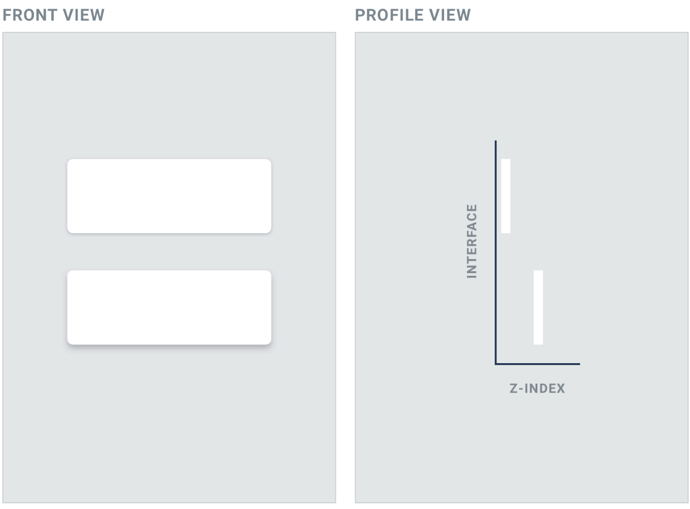
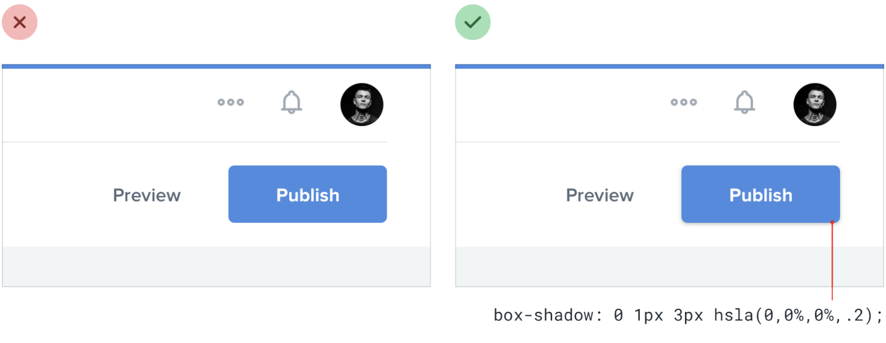

# 06｜用层次说明关系

**阴影的任务是帮助人看清关系，不是让所有东西都浮起来。** 先弄清什么是页面内容、什么临时展开、什么正在被操作，再选择合适的视觉线索。

[返回目录](README.md) · [阅读本章完整详解](deep-dive/06-depth-and-layers.md)

## 先看图：阴影可以暗示前后

*图源：Will’s S Design Note 课程中整理的 Refactoring UI，[利用阴影表现高度](https://www.notion.so/226886bc60ff8192b8b7f384a7340a10)。这是帮助理解的示意，不是阴影参数与物理高度的换算。*

*图源同上：[利用阴影表现高度](https://www.notion.so/226886bc60ff8192b8b7f384a7340a10)。*

图中轻阴影让按钮与背景更容易分开；最终还要在真实背景上检查轮廓是否清晰。

## 区分三种容易混在一起的状态

阴影可以表达表面之间的层次，但选中和键盘焦点分别回答不同问题，不能只靠同一种阴影区分。以课程列表为例：

1. **已选择**：用户选中了哪项练习？选中标记要留在那个对象上。
2. **临时展开**：操作面板从哪里来，关闭后回到哪里？它可以有边界或阴影，但不能挡住必要内容。
3. **键盘焦点**：下一次按键会作用在哪里？焦点可以在面板中移动，不等于所选练习发生了变化。

模态对话框还要处理背景交互、焦点进入与返回、关闭等真实行为；一层遮罩和阴影不会自动实现这些事。[W3C：模态对话框模式](https://www.w3.org/WAI/ARIA/apg/patterns/dialog-modal/)

## 阴影怎么选？

- 先从真实组件建立少量层次：普通页面内容保持平面，展开的菜单用边界或轻阴影分开，模态框再提供更明显的前后关系。把它们放在同一屏比较，确认各层含义清楚；不必给每个按钮都加阴影。不要只凭投影判断组件是否能点击。
- 深色背景上阴影可能不够明显，可结合表面明度和边界重新区分层次，同时检查文字和焦点；平台提供语义颜色时先用平台机制，再检查实际效果。
- 焦点、选中、按下、拖动中与完成是不同状态。按下时阴影变小，不等于操作成功。
- 如果内容需要拖动，按适用规范提供不依赖拖动的操作方式；键盘支持和单指针替代也需要分别检查。[W3C：拖动替代](https://www.w3.org/WAI/WCAG22/Understanding/dragging-movements.html)

**试一次：** 在你的作品中打开一个菜单或调整面板，依次检查：知道它属于谁吗？焦点在哪里？取消后能回来吗？变窄或放大文字后，按钮和焦点是否仍完整？

> 想了解双层阴影、深色主题、重叠、焦点及更多平台边界？[打开完整详解](deep-dive/06-depth-and-layers.md)。
