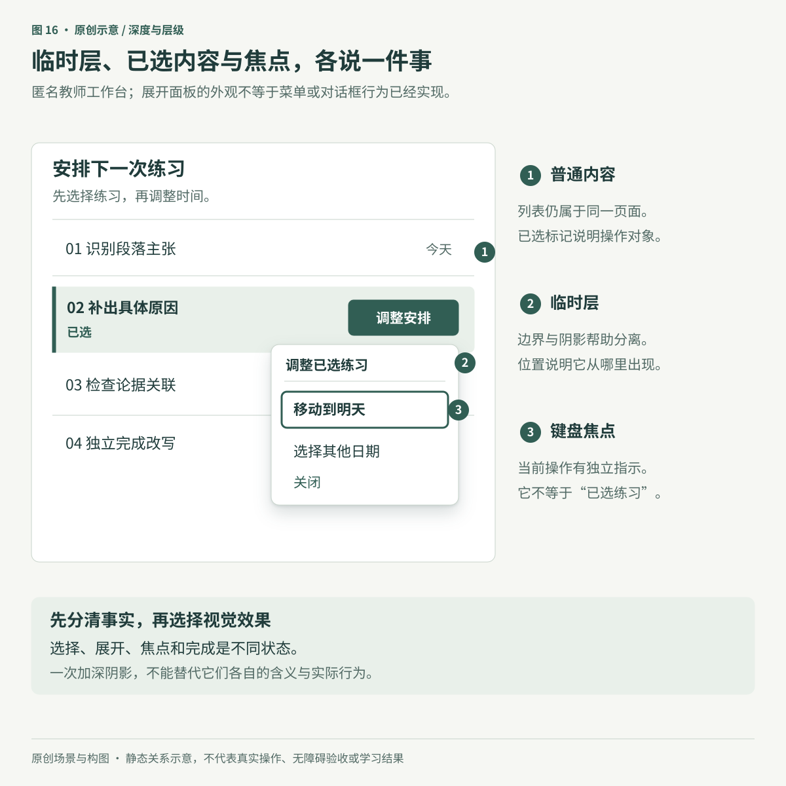
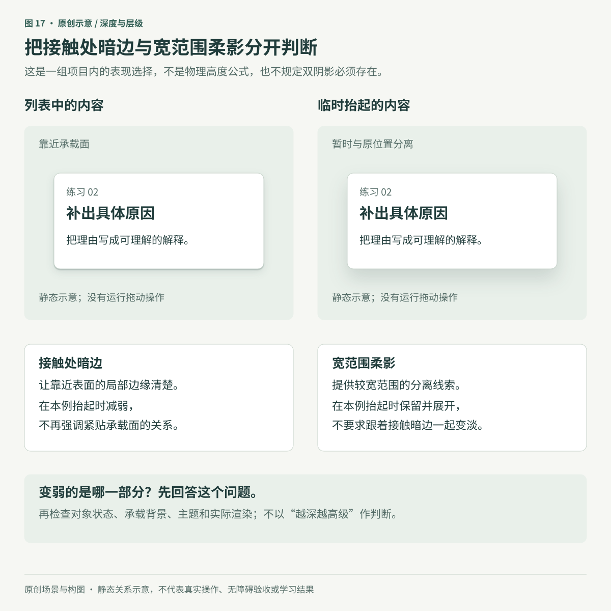
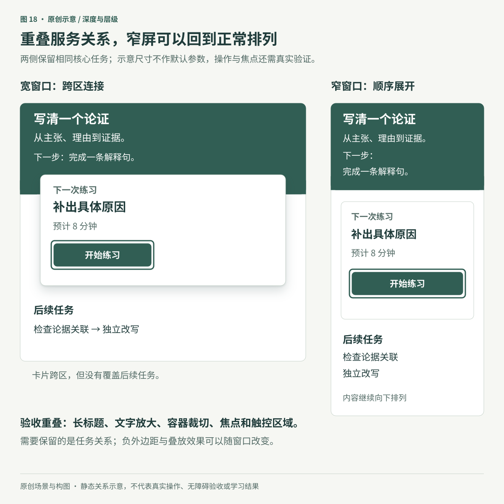

# 让层次说明关系：深度、阴影与临时界面

**原创专题初稿。** 本章完整读取了资料库中 Refactoring UI「Creating Depth」五个整理页的导出正文，并使用主审读者在原生 Notion 页面中留下的32次图片引用观察记录。本文作者没有亲自重新查看源图；页面上下文观察完成不等于素材URL与文件哈希身份已经核验。图16–18是新编的匿名课程工作台示意，不使用课程原图，也不代表可运行产品。

教师想把一项练习调整到明天。他需要知道哪项练习被选中，哪组操作刚刚展开，以及现在按键会触发什么。如果这三件事都用“加一层阴影”表示，界面可能更立体，关系却仍然混乱。

深度设计的起点是这些关系：什么属于页面，什么暂时盖在页面上，什么正在被移动，什么只是当前选择。明确它们之后，再决定是否使用阴影、表面颜色、边界或遮挡。这里的视觉前后与[信息重要性](02-hierarchy-and-actions.md)有关，却不是同一件事；一条重要提醒可以直接留在正文中，不必变成浮窗。

## 1. 给临时界面一个明确的来处和去处

先把代表页面中的对象分为具体职责，而不是先定五档阴影：

| 对象与状态 | 用户需要理解什么 | 可采用的表达 |
|---|---|---|
| 页面中的练习列表 | 哪些内容属于同一任务区 | 标题、间距、分隔或表面色 |
| 已选中的一项练习 | 后续操作针对谁 | 可见的选择标记、文字和选中状态 |
| 刚展开的操作面板 | 这是当前对象的临时操作 | 位置联系、清楚边界，必要时加阴影 |
| 键盘正在访问的操作 | 当前按键将作用于哪里 | 随焦点变化且持续可见的指示 |
| 正在移动的条目 | 哪个对象离开原位置，准备放到哪里 | 对象与原位置、候选落点及移动反馈 |

这些职责可以同时出现。例如，一项练习保持选中时，键盘焦点可以移动到“调整安排”的入口。不要让一次焦点移动自动改写选择事实，也不要让所有带阴影的卡片都暗示可拖动。

图16把三种视觉职责放在同一场景：列表保持稳定，临时面板与触发对象有位置联系，焦点指示只标当前操作。图中的面板没有遮罩；它不是一次模态对话框实现，也没有演示实际键盘行为。

如果确实需要模态对话框，还要处理背景不可交互、初始焦点、对话框内的键盘移动、关闭，以及关闭后焦点的合理返回。初始焦点不应机械地永远落在第一个按钮。投影与遮罩只是外观，不会自动实现这些行为。[W3C：Modal Dialog Pattern](https://www.w3.org/WAI/ARIA/apg/patterns/dialog-modal/)

## 2. 阴影是一组可调整的线索，不是高度尺

使用自定义阴影时，可以分别考虑两件事：对象附近是否需要清楚的分离，较宽范围是否需要柔和的前后关系。把它们拆开，通常比只不断加深一个模糊阴影更容易判断变化的用途。

一种可选的表达是使用两个分量：较窄的接触处暗边，以及范围更大的柔影。它借用了物体与承载面关系的视觉类比，不是对真实光照的完整模拟。无需每个组件都用两个，也没有证据要求所有项目固定使用五级。

图17中的变化是本例的表达选择：抬起时，接触处暗边减弱，宽影仍然存在。课程整理文字把高度增加概括为“双重阴影都变淡”，但主审读者记录的示例显示，减弱直至消失的是贴近表面的接触分量，宽影并不需要同步减弱。不能从该图推出所有光源、材质和界面都遵循一条亮度曲线。

同样，“光从上方来”可以成为某套界面的简化假设，帮助高光与暗边保持一致；它不是所有真实场景的光源事实。若选用这种表达，同类组件不要无缘由地一处上亮下暗、一处上暗下亮。原生产品已有系统材料时，先沿用平台语义，不必重建一套拟物光照。

SwiftUI 的阴影API分别定义模糊半径与横纵偏移，没有提供“参数换算物理高度”的通用公式。Android Compose Material 3 的 `Surface` 也把色调高度和阴影高度分开；其中阴影并不改变绘制顺序的 `zIndex`。所以“看起来浮起”“阴影更宽”和“实现上绘制在前面”需要分别确认。[Apple：shadow](https://developer.apple.com/documentation/swiftui/view/shadow(color:radius:x:y:))、[AndroidX：Surface 参数说明](https://github.com/androidx/androidx/blob/androidx-main/compose/material3/material3/src/commonMain/kotlin/androidx/compose/material3/Surface.kt)

### 几个容易误判的结果

- 每张内容卡都加大阴影，可能让它们共同抢占注意；先判断是否真的需要分层。
- 让按钮按下时阴影变小，只能表现按压反馈，不能宣告提交已经成功。
- 用外观表现条目被抬起，仍需提供可判断的落点、取消和完成结果。
- 只改阴影却同时观察到更好效果，不能忽略示例中可能一起变化的底色、边框或布局。

对于网页拖动功能，WCAG 2.5.7（AA）还要求提供不需拖动的单指针替代，必要操作及未改动的用户代理功能有例外。仅支持键盘并不自动满足这项要求；例如可点击的“上移／下移”能为列表调整提供另一条路径，但仍要实际实现和验证。[W3C：Dragging Movements](https://www.w3.org/WAI/WCAG22/Understanding/dragging-movements.html)

## 3. 深色模式要重新判断表面关系

白色内容面放在浅灰背景上，可能形成靠前的感觉；这不能概括为“任何颜色更浅都必然更近”。背景、相邻对象、边界和主题一起影响判断。课程中的明亮主题图，只能说明它所采用的组合。

Apple 对 iOS/iPadOS 的深色背景区分 base 与 elevated，较亮的 elevated 背景帮助前景层显得靠近。使用相应系统颜色可保留这种适配，但这不要求所有暗色网页加入白色投影。还应分别及组合检查提高对比度、减少透明度等设置。[Apple：Dark Mode](https://developer.apple.com/design/human-interface-guidelines/dark-mode)

Material 也需要区分设计角色与实现版本。当前 Flutter 文档描述用 tone-based surfaces / surface containers 代替旧的透明叠色模型；其 Card 文档不再推荐 `surfaceTintColor`。而所读 Android Compose `Surface` 仍保留有条件的 `tonalElevation` 行为。不要把两者拼成一条规则，也不要据此擅自迁移现有项目。[Flutter：ColorScheme](https://api.flutter.dev/flutter/material/ColorScheme-class.html)、[Card.surfaceTintColor](https://api.flutter.dev/flutter/material/Card/surfaceTintColor.html)

更实用的检查是：切换主题后，临时层是否仍与后方分开，正文是否仍可读，选中与焦点是否仍有明确含义。系统材料或语义色提供适配基础，不替代具体界面的验收。当前 Apple 的 Liquid Glass 建议还有功能层与内容层的用途边界，不能把新系统材料倒推成旧课程图例的规则。[Apple：Materials](https://developer.apple.com/design/human-interface-guidelines/materials)

## 4. 重叠可以表达归属，也会占用别人的空间

重叠的好处，是让两个区域产生明确联系。例如，课程概览中的“下一次练习”跨在介绍区与任务区之间，可以成为从了解课程到开始练习的连接点。但在信息很密的工作台里，这个效果也可能挡住任务、截断按钮或增加滚动负担。

先问重叠解释了什么，再检查它占用了哪一块空间。若只是想让卡片更特别，通常可以先尝试对齐、表面色或标题层级。

图18保留课程名称、练习任务、时长和开始入口，宽窄窗口采用不同布局。“预计8分钟”是场景设定，未测量学习耗时。窄屏不需要维持重叠这一装饰条件。变化的目标是让任务继续可读、可操作，而不是把整张卡片缩到同样的比例。

负外边距是实现重叠的一种手段，课程中的负值不是通用参数。无论采用负外边距、定位或网格，都应检查内容变长、文字放大、窗口变窄，以及浮层打开后的情况。特别注意容器裁切：图形没有越界，不代表焦点环、菜单或触控区域没有被截掉。叠放顺序也不能靠阴影大小推断。

重叠头像或缩略图时，可通过与当前承载面相容的分隔边保留轮廓；白色边框只适用于某些浅色背景。主题变化后需要重新配对。若这些图像是操作入口，还要能辨认具体对象并方便选中；本章没有为它们规定固定边框厚度或触控尺寸。

## 5. 把必要信息从阴影中解放出来

阴影可以帮助看出层次，但可操作性、焦点和对比仍要独立检查。

**焦点。** 静态装饰阴影不表明焦点正在移动。WCAG 2.4.7（AA）要求可见焦点，具体形态可以不同。专门随焦点改变的阴影并非一律不可用；W3C 对 2.4.13（AAA）的解释允许投影形态，但只将达到足够对比变化的面积计入判断。不能把“2 CSS px 周界面积、同像素状态变化至少3:1”误写成所有AA页面必须使用同一条2px线框。[W3C：Focus Visible](https://www.w3.org/WAI/WCAG22/Understanding/focus-visible.html)、[Focus Appearance](https://www.w3.org/WAI/WCAG22/Understanding/focus-appearance.html)

**必要边界与状态。** 1.4.11（AA）要求识别控件、状态或理解图形所必需的视觉信息与相邻颜色至少3:1，存在停用及未改动用户代理外观等例外。并非每个装饰卡片边框都必须达到3:1，也不能只找阴影最深的一点就宣布整个必要指示合格。增加容器阴影不会自动修复其中低对比的正文。[W3C：Non-text Contrast](https://www.w3.org/WAI/WCAG22/Understanding/non-text-contrast.html)

**用户颜色偏好。** 所读 CSS Color Adjustment 草案规定，强制颜色模式启用且元素采用 `forced-color-adjust: auto` 时，`box-shadow` 和 `text-shadow` 会计算为 `none`。承载必要信息的边界或焦点要有在该环境中仍可用的表达，并在目标浏览器检查；不要为了保留投影而一概阻止用户颜色调整。[W3C：强制颜色模式](https://www.w3.org/TR/css-color-adjust-1/#forced-colors-properties)

**运动。** 临时层的出现、对象抬起和按压可以使用短暂运动解释变化，但不能成为重要信息唯一的载体。尊重减少动态偏好，并保留更平静的反馈。Web 的交互触发非必要运动可关闭是 WCAG 2.3.3（AAA）的要求，不能写成AA禁止所有动画；本章也不给所有设备统一规定时长。[Apple：Motion](https://developer.apple.com/design/human-interface-guidelines/motion)、[Reduced Motion 评估说明](https://developer.apple.com/help/app-store-connect/manage-app-accessibility/reduced-motion-evaluation-criteria)、[W3C：Animation from Interactions](https://www.w3.org/WAI/WCAG22/Understanding/animation-from-interactions.html)

## 6. 在一个任务中验证层级

以“把明天要练的题目重新安排”为例，可以这样推进：

1. 写出对象与真实状态：哪项已选、哪个面板展开、什么尚未保存、何时才算安排完成。
2. 先用内容、对齐和分组让普通页面可读，再给确有需要的临时层加入分离线索。
3. 只为反复出现的职责整理样式；检查是否能删掉无用途的阴影档位。
4. 比较默认、悬停、按下、键盘焦点、移动中与完成后的适用状态；不要用同一个效果代替全部状态。
5. 在长标题、窄屏、文字放大、明暗主题及适用辅助设置下检查重叠、裁切和层次。
6. 真正完成一次打开、移动、取消、确认与恢复。对话框、菜单和拖动按其各自机制测试，不能只看截图。

| 检查对象 | 可留下的证据 | 不能单凭它证明 |
|---|---|---|
| 静态构图 | 哪些对象分离、哪些内容被遮挡 | 菜单或对话框行为正确 |
| 键盘与单指针操作 | 焦点、关闭、替代路径能否完成任务 | 所有辅助技术和设备都兼容 |
| 状态结果 | 实际安排是否保存，失败能否恢复 | 学习者因此学会了知识 |
| 主题及偏好 | 指定组合下的层次、对比与反馈 | 所有平台拥有同样的规则 |
| 使用者解释 | 能否分清已选、正在移动、已经完成 | 某个阴影数值产生了独立因果效果 |

本章三张SVG只用于解释机制，已实际渲染并逐张检查中文、边界和图文一致性。它们没有实现输入、拖动、菜单或存储。用于教学产品时，浮起的练习卡可以帮助定位当前任务；“放到了完成列”仍不等于学习者已经能独立完成相近的新题。

## 来源与审读范围

五页属于二手课程整理，整理者身份未核实。主审读者于2026-10-30从标题至页尾分屏观察32次图片引用；本文作者使用其书面记录，未独立重看源图。原作作者与著作目录另据[Refactoring UI 官网](https://refactoringui.com/)核对，五个英文标题均有对应；未逐页对照付费出版物或版次。详见[原作登记](../sources/refactoring-ui.json)。

| 来源ID | 整理页 | 使用与必要限定 | 图片引用观察 |
|---|---|---|---:|
| RUI-DEPTH-01 | Emulate a light source | 光向一致的可选类比；正文与若干图注位置、阴影方向有不一致，不照抄代码或解释 | 12次 |
| RUI-DEPTH-02 | Use shadows to convey elevation | 按关系选择阴影；五档为示例，z-index不是物理高度，按下不是提交成功 | 7次 |
| RUI-DEPTH-03 | Shadows can have two parts | 分开接触分量与宽影；高度变化不要求两者同步变淡，图中分隔符不当可运行CSS | 5次 |
| RUI-DEPTH-04 | Even flat designs can have depth | 颜色和硬边也可分层；浅近暗远限示例情境，截图不证明表单与购物车行为 | 3次 |
| RUI-DEPTH-05 | Overlap elements to create layers | 重叠表达联系；负外边距、白边厚度均非默认值，裁切、响应与操作需实测 | 5次 |

任务分类、匿名课程场景、三张图和验证步骤是本章的原创组织。官方补证只核对文中相关文字段落或参数，不包含官方媒体观看；部分 Apple HIG 文字来自搜索工具返回的官方索引正文，直接脚本页面未完整取得。AndroidX 源代码为核验时的主分支，未固定到用户项目版本；CSS Color Adjustment 所读为2025-12-16候选推荐快照。规范、实现和产品验收保持分开。

详细范围见[专题来源登记](../sources/depth-and-layers.json)与[图示登记](../assets/diagrams/register.json)。32次引用观察不等于32份独立素材；本章不发布私人页面链接或课程媒体，也不表示全19个资料区的媒体已经补完。
