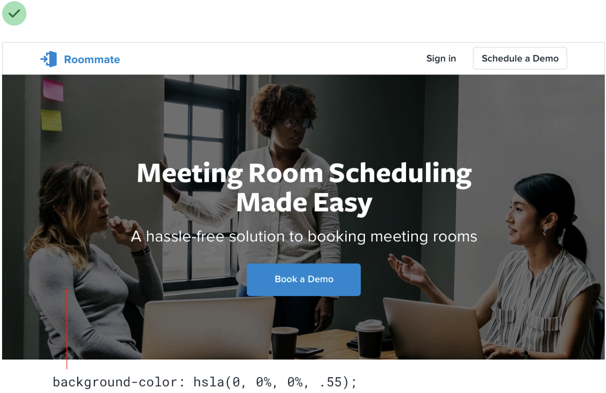
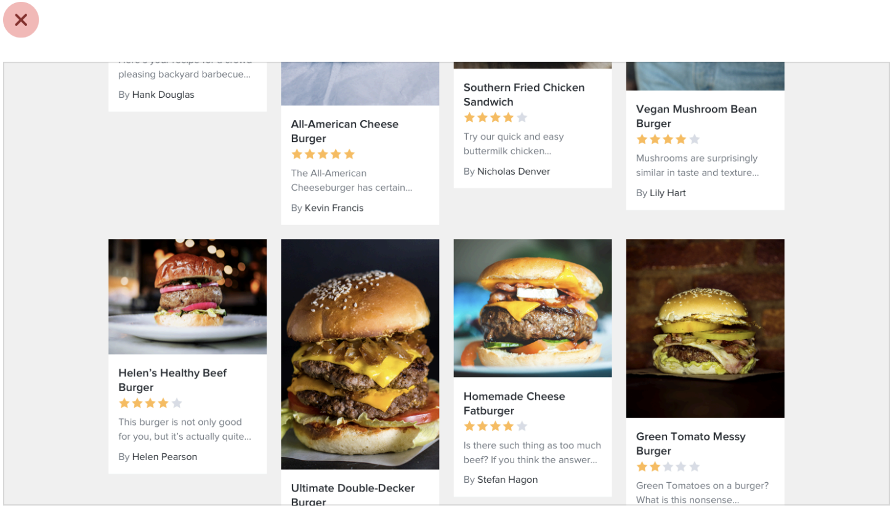
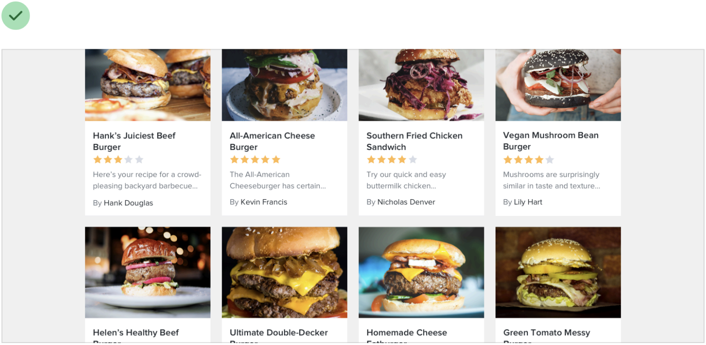

# 07｜图片：先想清楚它要传达什么

一张图既可能是装饰，也可能是用户需要看清的内容。选照片、加文字和裁切之前，先问：**这张图里什么信息不能丢？**

## 01 / 把文字放到看得清的地方

下面这张课程示例里，白色标题横跨亮窗户和深色墙面：同一句话在有些位置清楚，有些位置就融进了背景。

**调整前：白字与亮窗户重叠**

*课程示例：Refactoring UI《Text needs consistent contrast》，[Notion 整理页](https://www.notion.so/226886bc60ff81cc837fd7c33926663a)。*

**调整后：增加暗色承载层**

一种处理是在照片上增加暗色承载层，让白字更稳定地突出：

[放大看调整前的原图](../assets/course-examples/07-photo-text-before.png) · [放大看调整后的原图](../assets/course-examples/07-photo-text-overlay.png)

**看图时注意：** 原例展示了黑色遮罩，也同时改变了照片明暗。它能帮助理解方法，但图中的 55% 不是每张照片都通用的数值，也不能代替对实际文字区域的对比检查。

相机取景画面与这张静态照片不同：光线、主体和背景会持续变化。因此在你的相机界面，可以先试这三件事：

1. 把文字放在稳定的底色上，或避开照片中的亮暗交界。
2. 用浅色、深色和复杂背景分别检查，尤其看文字正下方。
3. 检查换行、放大后文字的新位置；不能只验收一张漂亮示例。

## 02 / 整齐裁切之前，先保住内容

课程里这组食谱卡片展示了上传照片的挑战：原图大小和比例各不相同，页面容易出现参差。

**调整前：照片比例不同**

**调整后：照片裁成相近高度**

[放大看调整前的原图](../assets/course-examples/07-upload-before.png) · [放大看调整后的原图](../assets/course-examples/07-upload-after.png)

*课程示例：Refactoring UI《Beware user-uploaded content》，[Notion 整理页](https://www.notion.so/226886bc60ff81cf96e3df611fbbcb7d)。第二张图说明统一比例的方法，不代表裁切适合所有内容。*

食谱缩略图可以尝试统一比例；但学生作业、票据、聊天截图或图片里的文字，可能因为裁切而丢失关键条件。**按图片用途判断是否能裁**：需要检查原始细节时，提供完整图入口并保留原图；如果裁切只是呈现方式，也应确认没有改变必要内容。

*原创示意：填满容器可能裁掉两侧；完整显示可能留下空白。图示是教学例子，不是实际产品截图。*

## 03 / 缩小后还需要读什么？

一张完整截图能说明整体关系，但缩小后细字可能读不清。可以同时给一张整体图和一张局部图；如果展示的是手机界面，就检查真实窄屏，而不是把桌面图压得更小。

除了看缩略图是否清楚，还要想一想：如果图片无法加载，或者读者通过读屏工具获取信息，他还能知道图里与任务有关的内容吗？

例如，图表应提供能说明主要信息的文字；作为按钮的图片应说明会执行什么动作；纯装饰图则不必让读屏重复描述。具体写法取决于这张图在当前页面的作用。[W3C 图片替代文本决策树](https://www.w3.org/WAI/tutorials/images/decision-tree/)

## 拿自己的作品试一次

找一张页面中的真实图片，依次检查：

- **意义：** 图片在帮助辨认、解释，还是只营造气氛？
- **阅读：** 文字放大、换图、屏幕变窄后，还能看清吗？
- **完整：** 题号、人物或细节被裁掉了吗？能否查看原图？
- **失败：** 加载失败时，用户是否知道发生了什么？

这一轮先修最影响理解的一处，不必同时重做全部图片。

[深入阅读：图片用途、裁切、技术与验收完整说明](deep-dive/07-images-with-purpose.md) · [返回手册目录](README.md)
