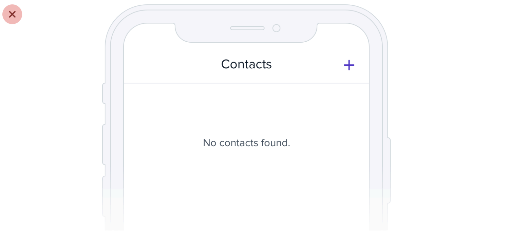
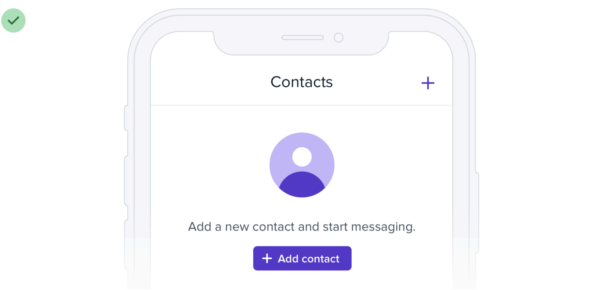
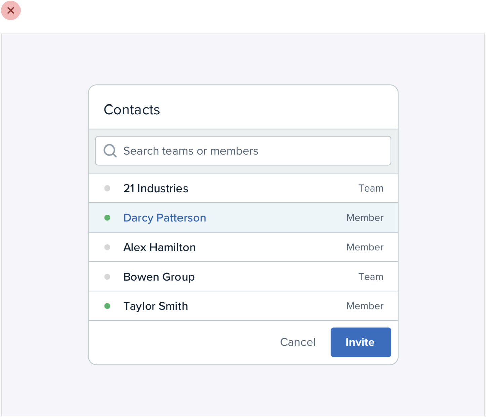
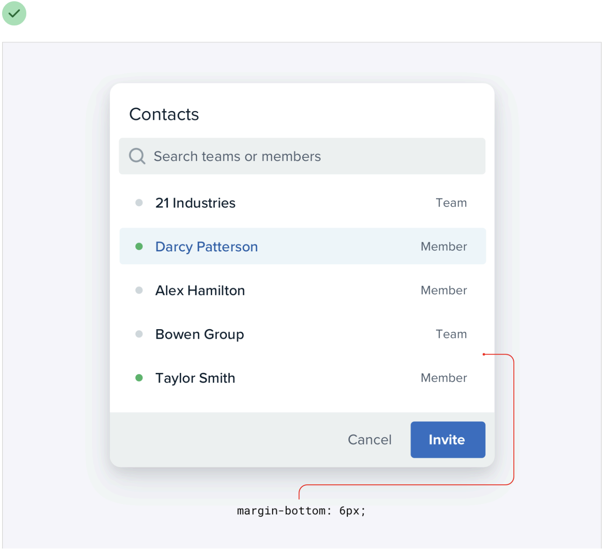

# 08｜收尾：让页面说清楚真实状态

一个页面“空着”，可能是第一次使用、没有搜索结果，也可能是加载失败。视觉设计可以让它更易理解，但**状态文案要与真实原因一致**。

## 01 / 空白页也是第一次体验

看看课程里这个联系人页面：页面写着“没有找到联系人”，却没有解释为什么为空；首次使用的人还要自己猜下一步。

下一张图告诉用户可以添加联系人，并提供一个清楚的按钮。

*课程示例：Refactoring UI《Don't overlook empty states》，[Notion 整理页](https://www.notion.so/226886bc60ff816ab5f3fdf71d91d18f)。图示说明首次添加的思路，没有证明实际用户完成率。*

但不要把它复制到所有空页面：搜索无结果时，可能需要“清除筛选”；读取失败时，需要说明失败并提供重试；用户没有权限时，需要解释如何申请访问。

| 真实原因 | 可以先说清什么 | 可能的下一步 |
|---|---|---|
| 第一次使用 | 这里还没有内容 | 添加或导入第一项 |
| 搜索没有结果 | 当前条件没有匹配项 | 调整关键词或清除筛选 |
| 加载失败 | 暂时无法读取 | 重试；保留已输入内容 |
| 操作已完成 | 明确哪一项完成了 | 查看结果或继续下一步 |

这些文字是示例。实际按钮必须对应真实可用的操作，失败也不能被写成“已完成”。

*原创示意：根据不同原因选择不同呈现。它不是已运行的功能。*

## 02 / 减少边框，保留关系

状态说清楚后，再检查页面结构是否也容易辨认。这组课程图是同一个联系人面板：原图用边线分隔多处区域，后续版本用背景、间距和局部强调来区分。

*课程示例：Refactoring UI《Use fewer borders》，[Notion 整理页](https://www.notion.so/226886bc60ff81c88a58eb4bd0948b1a)。图中同时调整了间距、背景及边框，不能将整体效果归因于某一个数值。*

**要检查的不是“边框越少越好”，而是去掉以后，用户还能不能看出哪里能输入、哪一行被选中、哪些信息属于一组。** 键盘焦点、错误提示和选中状态也要各自能辨认。

## 03 / 等待、成功、失败分开说

以相机为例，按下快门、正在处理、文件已经保存，是三个不同的时刻。不要因为画面暂时消失，就提前告诉用户“已保存”。以学习工具为例，“答案已提交”和“老师已批改”也不是同一状态。

如果失败了，优先保留用户刚才的输入，并说明能做什么。比如：“暂时没能保存，内容仍在这里。请重试。”这句话只有在内容确实还在、重试确实可用时才成立。

## 给已有页面做一次收尾

1. 打开一个真实页面，找到一处空白、等待或失败状态。
2. 写下系统真正知道的事实，和它还不知道的事。
3. 检查按钮是否能完成它承诺的动作，失败后数据是否保留。
4. 去掉一处多余装饰或边线后，重新检查结构、选中状态和焦点。

[深入阅读：状态、装饰、边框与完整验收说明](deep-dive/08-finish-and-real-states.md) · [返回手册目录](README.md)
