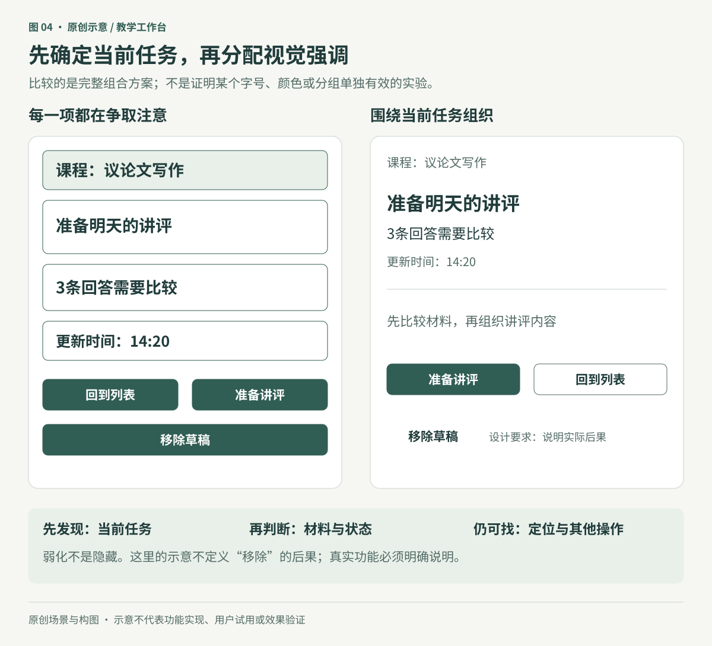
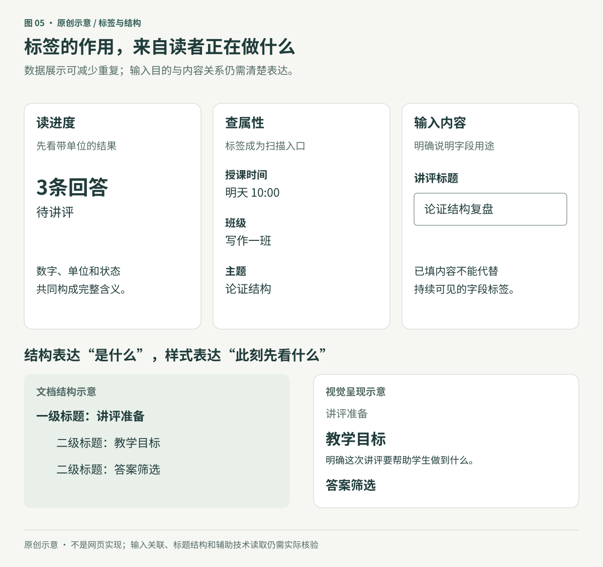
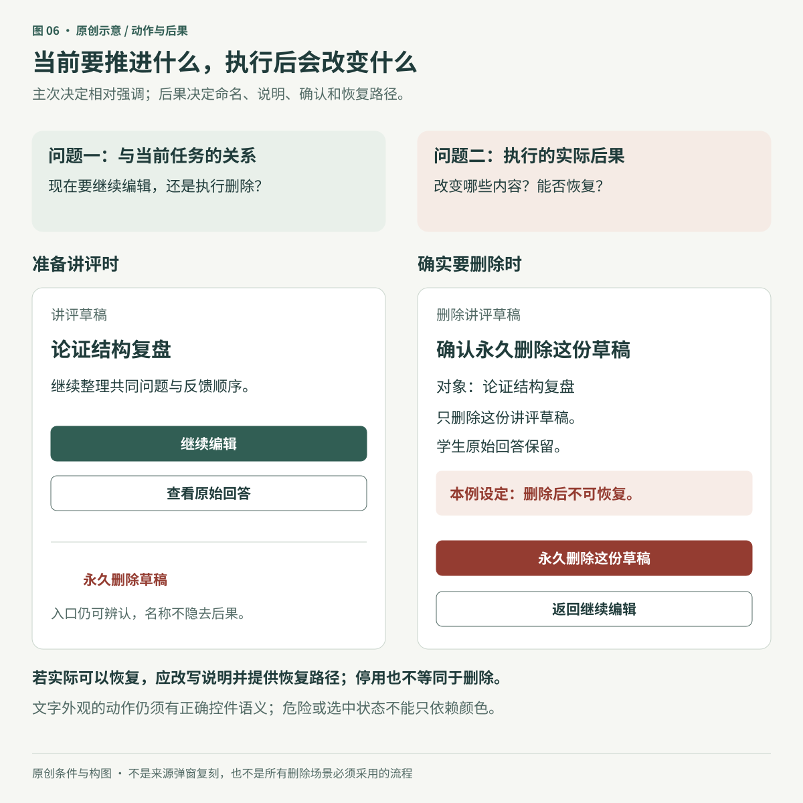

> **进阶版说明：** 以下保留早期长版内容，其“未发布原图”等措辞描述的是当时版本的范围。当前图文版按用户授权展示并标注课程来源。

# 信息层级与操作优先级：让人看见当前任务

**原创专题初稿。** 本章使用资料库中 Refactoring UI「Hierarchy is Everything」八个整理页面的文字，以及主审读者对32次图片引用的页面观察记录。本文作者读取了记录，没有独立重看源图；页面观察完成不等于素材URL与文件哈希已经逐一核验。三张配图是匿名教学工作台的新示意，不是来源截图或已测产品。技术性无障碍边界另据本章链接的 W3C 官方资料核对。

教师打开讲评工作台，想从几条回答中找出共同问题。如果课程名称、更新时间、每行按钮和当前任务都同样醒目，页面虽然整齐，仍然需要反复判断先看哪里。

信息层级要解决的是**当前情境下的注意顺序**。它不意味着永久给某一类信息排高低，也不意味着把次要内容处理得难以辨认。同一条“授课时间”，在准备讲评时可能是背景信息，在确认明天行程时却应成为查找重点。

## 1. 先排任务，再排视觉

把页面上的内容分成三个问题：

1. 使用者现在要判断什么或完成什么？
2. 完成这件事需要哪些依据、限制和状态？
3. 哪些内容只是帮助定位，或属于暂时不需要的其他操作？

本章例子的当前任务是“准备明天的讲评”。课程名帮助定位，待比较的回答提供材料，更新时间帮助判断新旧；“移除草稿”虽然需要可发现，却不是此刻最值得强调的动作。

图04同时调整了字号、重量、分组和操作样式，右侧另加方法说明与设计要求批注，因此是一个组合方案比较，不能拿它证明某一项改变单独带来效果。来源中的工作台对照也改变了信息组合和色彩分配，不能照文字概括成“布局和颜色都没有变”。

可以先不放大主标题，转而检查周围是否有过多粗字、深色填充、边框或独立面板。这些元素重复出现时，会与正在处理的内容竞争。削弱其视觉重量，可能比继续扩大主元素更合适。

弱化仍要保留功能：当前导航可以用文字、位置标记或背景表达；其他入口仍应看得清、认得出。不能把“减少竞争”理解为所有侧栏都要同色，也不能让用户找不到必要的返回路径。

## 2. 字号、字重和对比要一起看

字号只是建立层级的一种手段。把所有重要内容都放大，会很快挤压真实内容；把辅助信息不断缩小，则可能让必要条件难读。

更可控的做法是先确定文字角色，再比较重量与空间关系。例如，保持课程说明的可读字号，用更明确的字重表达当前任务；将更新时间放在较安静的位置，而不是降到几乎看不见。

图标也有重量。相同外框里的实心图形，可能比旁边的正常字更抢眼。可选择更合适的图标形式、减少不必要的装饰，或调整颜色；并非只能降低透明度。分隔线同样要看用途：装饰分隔和识别控件所必需的边界，不能用同一标准随意弱化。

在网页中，WCAG 2.2 的文字对比要求通常为至少4.5:1，大字有3:1门槛，并另有明确例外。不能仅因文字是“辅助信息”就视为装饰而免除要求；大字定义也不能把原笔记中的px与pt混用。[W3C：Contrast (Minimum)](https://www.w3.org/WAI/WCAG22/Understanding/contrast-minimum.html)

对识别控件、状态或理解图形所必需的非文字视觉信息，相关要求通常为与相邻颜色至少3:1，并有适用范围与例外；不是每条装饰线都必须同样处理。[W3C：Non-text Contrast](https://www.w3.org/WAI/WCAG22/Understanding/non-text-contrast.html)

这些是技术底线的一部分，不是“测到一个比例就证明整个界面无障碍”。仍需检查文字、状态、焦点、输入方式与实际任务。

### 彩色背景上的次要文字

不要仅凭“灰色”或“同色系”决定可读性。文字应相对于它实际覆盖的背景判断。半透明文字会与底色混合；背景有纹理、摄影或动态画面时，不同笔画位置可能得到不同结果。

不透明且协调的文字色可以减少背景透入笔画，但它本身不能保证整块背景上的对比。必要时调整承载文字的底层、位置或图像处理，并在真实背景上检查。本章没有把来源标题“避免灰字”写成禁止使用某一种颜色。

## 3. 标签是否突出，取决于读者在找什么

展示数据时，一些机械的“标签：值”可以改成自然表达，例如“待讲评：3”改为“3条回答待讲评”。这没有删除含义，只是让内容更容易扫读。数字的单位、范围和时间条件仍需保留。

如果用户是在查找某个属性，例如授课时间、所在班级或练习类型，标签本身就是扫描入口，此时应让它足够醒目。没有一个“所有标签都应该淡”的规则。

图05明确分开了数据展示和输入。来源的“Labels are a last resort”一开始就排除了表单，不能把它用成删除输入标签的理由。网页接受输入时，应提供适当标签或说明；只给辅助技术一个名称，也不自动解决所有用户在视觉上不知道填什么的问题。[W3C：Labels or Instructions](https://www.w3.org/WAI/WCAG22/Understanding/labels-or-instructions.html)

同样，视觉上较小的页面标题仍可以承担重要结构角色。不要为了得到较小字号就随意改变标题等级，也不要只画粗字却丢掉结构关系。WCAG要求由呈现传达的信息、结构和关系能够被程序确定，或在文字中提供；应按平台正确表达标题、列表、分组和标签关系。[W3C：Info and Relationships](https://www.w3.org/WAI/WCAG22/Understanding/info-and-relationships.html)

本章示意图不是网页实现。若实际需要视觉隐藏标题，必须采用适用实现并检查辅助技术读取，不能仅凭一张图宣称已经保留语义。

## 4. 操作主次与操作后果是两个维度

“继续准备讲评”与“永久删除草稿”都可以是动作，但它们与当前任务的关系、做错后的影响不同。

> Every action on a page sits somewhere in a pyramid of importance.

—— Adam Wathan 与 Steve Schoger，[《7 Practical Tips for Cheating at Design》](https://medium.com/refactoring-ui/7-practical-tips-for-cheating-at-design-40c736799886)，第 7 节，2018-02-20。

**本章译：** 页面上的每项操作，都处在重要性金字塔的某个位置。

原文同时承认操作语义的重要性。这句话描述当前页面中的相对主次，不能读成永久等级或固定按钮数量。

先回答当前步骤要推进什么，决定它需要多大的视觉强调；再回答执行会改变什么、能否恢复，决定命名、说明、确认和恢复路径。不能因为某个动作危险，就让它在所有页面上永远最抢眼；也不能因为它是次要操作，就隐去后果。

图06中的“不可恢复”是这个原创例子明确设定的条件。真实产品若可以恢复，或只是暂停、停用，就必须按实际能力写明，不能把来源中的账户停用警告照抄成“所有数据永久丢失”。真正执行时采用怎样的确认，也应由后果与恢复能力决定，而不是每个动作一律弹窗。

视觉上像文字链接，不代表行为就应实现为导航链接。提交、删除、打开操作对话框等属于动作；应使用相应控件语义和键盘行为，使外观、名称与功能尽量匹配。[W3C APG：Button Pattern](https://www.w3.org/WAI/ARIA/apg/patterns/button/)

危险、选中或成功状态也不能只靠用户辨认红、绿、蓝来理解，应提供可见文字、形状等补充线索。[W3C：Use of Color](https://www.w3.org/WAI/WCAG22/Understanding/use-of-color.html)

这不要求所有页面只有一个按钮。列表可能有重复行操作，多选任务也可能有几个合理入口。需要判断的是当前任务中的相对主次，而非机械控制数量。

## 5. 一个可执行的修改过程

以“准备明天的讲评”工作台为例，可以这样推进：

1. **固定内容与目标。** 写下当前任务、必要材料、状态及操作，不先删内容来制造清爽。
2. **标出注意顺序。** 哪一项应先发现，哪一项帮助判断，哪一项只用于定位。
3. **查找竞争。** 查看重复的深色块、粗字、边框和同样醒目的按钮；先减少无助于当前任务的强调。
4. **保留含义。** 数值带单位和范围；输入有标签；选中有明确线索；低调操作仍能辨认后果。
5. **回到真实内容。** 放入长中文课程名、较长答案、不同数量和错误状态，检查换行与信息损失。
6. **分开验证。** 检查阅读与操作，再检查结构、对比与键盘/辅助技术；一个环节通过不替代其他环节。

不要把结果记录成“更高级了”就结束。更有用的记录是：原来哪个内容与任务竞争，修改了什么，观察到什么，还有什么不知道。

## 6. 反例与验证

| 看似合理的改法 | 为什么可能失效 | 更具体的检查 |
|---|---|---|
| 把所有辅助文字变得很淡 | 截止时间、价格条件或状态说明可能是重要判断依据 | 不看主标题，也能读清必要条件吗？ |
| 省去所有标签 | 输入目的、数字单位或相似属性失去解释 | 使用者能准确说出字段与数值代表什么吗？ |
| 每个动作按类别用鲜艳实心色 | 风险类别清楚，当前任务却不突出 | 进入页面后先找到哪个动作，为什么？ |
| 删除入口变小后不说明后果 | 主次改变了，误操作代价却没有减少 | 执行前能否说清删除对象、保留范围与恢复能力？ |
| 所有视觉标题都改成同一种标签 | 外观统一，结构关系可能丢失 | 阅读顺序、标题和输入关联是否仍正确？ |
| 用图标颜色暗示选中 | 不辨色或不熟悉约定时可能看不出状态 | 有没有清楚的文字、形状或位置线索？ |

可以让一位合适的使用者先说明页面用途，再完成查找、继续编辑与取消删除等任务。保留原话、路径和所需帮助，不在测试前解释“主按钮在哪”。单次探索可以发现问题，但不能推出总体改善比例。

涉及课程时，还要区分操作支持与教学提示：在管理工作台突出“待处理事项”可能节约查找；在需要独立判断的练习里，过度强调正确选项可能直接泄露答案。完成得更快不一定代表学得更好。

## 来源与完成范围

已核对到[Refactoring UI 官方出版页](https://refactoringui.com/)的著作与目录层面，尚未逐页对照出版PDF及版次差异，详见[主来源登记](../../sources/refactoring-ui.json)。下表保留实际整理页题名；其中“Emphasize by de-emphasizing”在官网目录中对应“De-emphasize to emphasize”。

| 来源ID | 整理页面 | 已观察图片引用数 | 本章保留的限制 |
|---|---|---:|---|
| RUI-HIER-01 | Not all elements are equal | 2 | 原图变化包含信息组合与布局，不能按单一变量归因 |
| RUI-HIER-02 | Size isn’t everything | 4 | 字号、字重及颜色数量是示例，不是跨平台固定规范 |
| RUI-HIER-03 | Don’t use grey text on colored backgrounds | 5 | 颜色名称不保证对比，不透明文字也需检查实际背景 |
| RUI-HIER-04 | Emphasize by de-emphasizing | 3 | 去掉面板背景适用于示例，不要求所有导航采用同一方式 |
| RUI-HIER-05 | Labels are a last resort | 6 | 原节讨论数据展示，不能用于删除表单标签 |
| RUI-HIER-06 | Separate visual hierarchy from document hierarchy | 2 | 视觉大小与文档结构分别处理；实现需核验 |
| RUI-HIER-07 | Balance weight and contrast | 5 | 图标和线条参数不是通用值；装饰与必要信息分开判断 |
| RUI-HIER-08 | Semantics are secondary | 5 | 本章重述为主次与后果两维，不把“语义次要”当实现原则 |

八页共32次图片引用观察，由主审读者于2026-10-30完成页面范围审阅；不声明32份独立素材，也不外推为全库媒体已读。技术边界所引W3C页面在本次写作中实际读取，其Understanding文档与APG是官方解释/实践指导，完整规范与具体适用条款仍应一并理解。

详见[专题来源登记](../../sources/hierarchy-and-actions.json)和[原创图示登记](../../assets/diagrams/register.json)。本章没有真人试用或学习效果结果，不以示意图作为产品效果证明。
