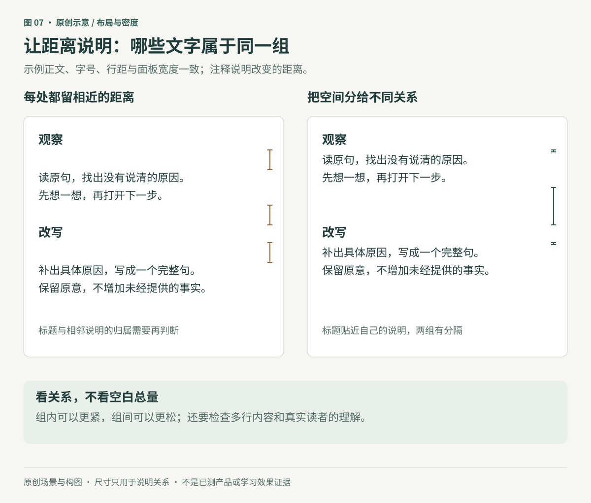
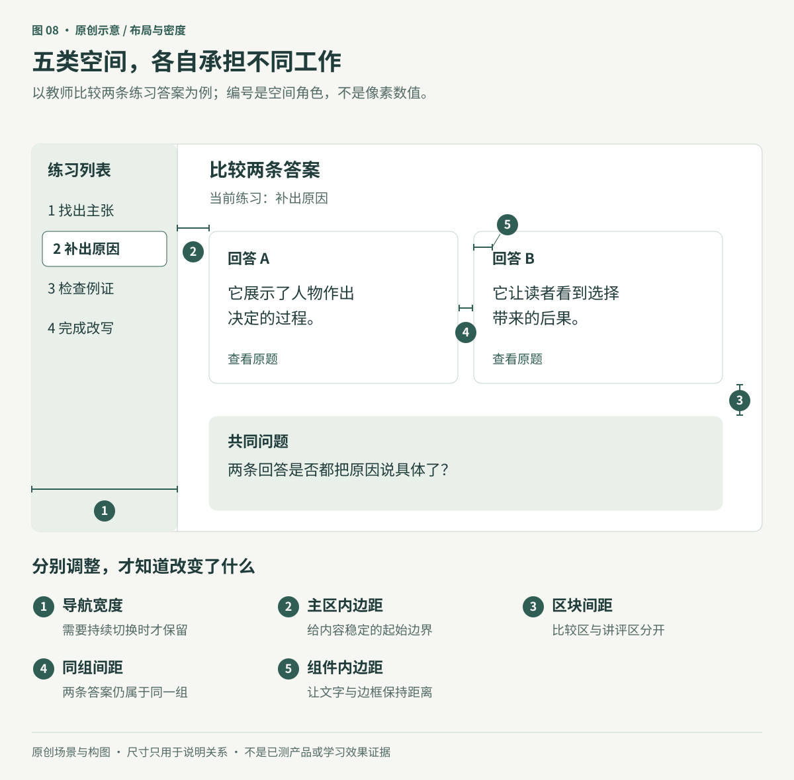

> **进阶版说明：** 以下保留早期长版内容，其“未发布原图”等措辞描述的是当时版本的范围。当前图文版按用户授权展示并标注课程来源。

# 布局、密度与空间关系：把位置留给任务

**原创专题初稿。** 本章读取了资料库中 Refactoring UI「Layout and Spacing」六个整理页面的导出正文，以及主审读者在原生 Notion 页面中留下的40次图片引用观察记录。本文作者没有独立重看源图；页面上下文中的观看完成，与素材URL、文件哈希逐一核验是两件事，后者尚未完成。三张配图使用新编的匿名课程工作台，不是课程截图、可操作产品或用户研究结果。

一个学习者正在修改解释句。他需要同时知道原句、修改要求，以及自己写到哪里。假如原句被放进很宽的区域，提示远在另一端，输入框又被巨大的标题挤到屏幕下方，界面即使没有重叠，也没有把空间用在这项任务上。

本章帮助决定三个问题：**哪些内容应靠近，哪些区域值得占据更多空间，窗口变小时什么需要重排。** 信息优先级可先参照[第二篇](../02-hierarchy-and-actions.md)；这里继续把优先级变成可观察的空间关系。

## 1. 先写关系，再调距离

距离会参与表达归属。一个标题如果离上段和下段同样近，读者需要额外判断它属于哪一段；一条反馈如果离自己的答案太远，也可能被理解为下一题的说明。这是一种需要检查的歧义，不是仅凭像素就能预测的错误率。

先把这次练习拆成三个关系组：

- **参照组：** 原句与当前修改要求，供学习者反复核对。
- **作答组：** 输入标签、自己的答案和与该答案有关的提示。
- **推进组：** 提交动作及提交后的结果说明。

对组内关系，可以用靠近、对齐和明确标签表达；对不同组，可以用更大的距离、分隔或不同承载区域表达。间距并非唯一手段，也不能替代正确的文字和结构。

图7保持示例正文、字号、行距和面板宽度一致，改变两组内容之间及各组内部的纵向距离；两侧注释分别说明相应判断。右侧没有全面扩大留白，而是收紧标题与说明的联系，把两组分开。它展示的是一个可检查的分组假设，没有证明实际读者必然更快或更少出错。

当长说明换成两行时，续行应继续属于同一项。不要为了维持整齐行高，把完整说明截断，也不要把续行之间的距离拉到与两项之间相同。需要固定高度的列表，应另外提供完整信息的获取方式，并实际检查查找任务。

### 反例：靠近不等于可以混在一起

“保存修改”和“放弃修改”都属于当前编辑过程，但相邻动作仍需清楚区分。为了增强组内联系而压缩可操作区域，可能带来误点。这里应同时看视觉关系与输入方式；空白、控件边界和点击区域不是同一尺寸。

## 2. 密度由要同时处理的信息决定

留白可以帮助分组，也会消耗可见空间。单次作答需要让原句、输入和必要提示靠近；教师比较多条答案时，则可能需要在一个视野里看见更多内容。两种任务可以使用同一字体与组件系统，却采用不同密度。

可以先给内容较宽松的空间，再逐步收紧，用来发现拥挤来自哪里。但这只是探索方法。若原句被推到屏外，学习者每写一句就要来回滚动，继续增加留白便不服务任务。反过来，把所有答案挤到一屏，也可能让教师难以判断反馈属于哪一条。

调整时分别处理五类空间，避免只改一个全局数字：

| 空间角色 | 决定什么 | 需要一起检查 |
|---|---|---|
| 导航所占宽度或高度 | 是否需要持续切换，名称是否能识别 | 当前任务得到多少空间；窄屏是否换成其他入口 |
| 主内容与外边界的距离 | 内容如何进入页面，边缘是否拥挤 | 可读宽度、长文换行和横向溢出 |
| 不同任务区块之间的距离 | 哪些内容各自成组 | 是否把需要同时比较的信息拆得太远 |
| 同组组件之间的距离 | 相关项目怎样排列 | 分组是否清楚，操作区域是否互相干扰 |
| 组件内部的距离 | 标签、正文、状态与边框怎样相处 | 加大内边距后，正文和操作是否被挤压 |

图8为解释五类角色而设置了练习导航。这不要求每个学习工具都有侧栏。若使用者只完成一次独立练习，一个返回入口与当前位置可能已经足够。图中的两条答案、选中项和文字均为原创示例，尚未验证教师是否愿意采用这种结构。

密度判断可以写成一句有条件的决定：“比较模式保留两条答案同时可见，单条编辑时给完整反馈更多空间。”这比“所有页面更紧凑”更容易落实，也更容易发现代价。

## 3. 给内容合适的宽度，不让它追着屏幕增长

窗口变宽，不意味着每个元素都应变宽。对于当前练习，输入区应能承载完整答案；简短的状态说明不必一直延伸到屏幕另一端；原句与修改要求也不应因为容器很宽而彼此远离。

先判断每个区域的尺寸角色，再安排布局：

| 尺寸角色 | 本章例子 | 何时改变 |
|---|---|---|
| 相对稳定 | 题号、简短状态标记 | 文字放大、语言或内容变化时重新检查，不强制永远固定 |
| 随可用空间伸缩 | 答案正文、输入内容 | 通过换行利用宽度，保留必要的最小可用空间 |
| 有适宜上限 | 单段阅读或单项作答区域 | 空间不足时可收窄；不随超宽窗口无限拉长 |
| 按任务重排 | 原句与作答区 | 并排已经妨碍阅读时改为上下排列，保留原有关系 |

并排显示适合需要比较且空间足够的情境；单列适合窄屏或逐步处理。同一页面里，一些元素稳定、一些伸缩，是合理组合。这里的“稳定”并不等于无条件写死物理像素。

图9保留相同任务、原句、要求、答案和按钮，按可用空间重新安排区域和尺寸，并让标题换行；讲解标注不属于产品内容。图中没有为了填满剩余空间而增加新模块。示意图本身不是响应式实现：焦点顺序、滚动、输入法和保存行为仍需在实际产品中检查。

### 网格是实现工具，比例只是其中一种选择

来源批评的是把每个区域机械地分配为固定百分比。不能据此说所有网格只支持百分比，更不能推出应弃用 CSS Grid。W3C 的 CSS Grid 轨道定义包含长度、百分比、弹性份额、基于内容的尺寸，以及 `minmax()`、`fit-content()` 等约束工具；设计判断是先决定各区如何变化，再选择合适实现。[W3C：CSS Grid 轨道尺寸](https://www.w3.org/TR/css-grid-1/#track-sizing)

固定侧栏也不是通用答案。如果窗口窄到主区无法完成任务，应考虑替代导航或重新排列；不能一边保持侧栏宽度不变，一边把正文压成很短的行。切换结构时还要保留当前位置与返回路径，避免为了省空间丢失方向。

## 4. 系统减少重复选择，也应允许有理由的变化

在每个地方随意选择相似数值，会增加维护和比较成本。可以从已认可的代表页面中，留下少量间距与尺寸候选，并说明它们承担什么角色，例如“标题与所属说明”“同组答案”“不同任务区块”。

但“采用系统”不等于所有距离相同，也不要求所有值必须遵循一个数学比例。组件内部的小变化可能改变图标重量或文字容纳；宽容器的小变化也可能恰好触发换行。因此，“相差很少”不能自动当作“没有影响”。

本章建议的执行顺序是：

1. 用真实标题、说明、答案和状态做一个代表页面。
2. 先解决归属不清、内容缺失和操作拥挤，再整理反复出现的距离。
3. 给可复用值分配角色，说明在哪些组件和状态使用。
4. 在长内容、窄屏和文字放大时检查；有理由的例外保留理由，不以局部硬塞维持表面统一。

标题、正文、按钮文字和可操作区域应分别调整。把桌面全部缩小到某个百分比，可能让正文难读、按钮难点，仍不能保证标题占据合适空间。字体相对单位本身没有问题，问题在于不经过检查就让所有关系永远锁在同一比例。

原笔记中的手机正文14px、小按钮12px、某个表单宽500px等都是特定图例，不能成为中文、原生应用或触控目标的默认规格。实现时应结合项目已支持的平台、真实内容、文字设置与输入方式核对。

## 5. 把这些判断用于一次改写练习

以下是原创设计演示和待执行的验证计划，没有真实学习者结果。

设定任务为：“看一句含糊的解释，把缺少的原因补成完整句，再提交。”本例给定的背景是：所选材料确实展示了人物作出决定的过程。原句为“我选择这个例子，因为它比较好。”要求是“补出具体原因”，示范答案为“它展示了人物作出决定的过程。”这个背景属于原创设定，不是从真实学生回答推得的事实。

**先定同时可见的内容。** 原句和要求属于参照组，答案属于作答组。宽屏中并排有助于反复对照；窄屏按参照、作答、提交顺序排列。不能为了减少页面高度，删掉原句或把教学要求缩成难懂图标。

**再定组内与组间关系。** “你的改写”靠近输入区；若出现与答案有关的错误或反馈，也应能明确归属。提交结果单独表示，避免把“已保存草稿”与“已提交给老师”混在一起。具体状态设计承接第一篇的任务流程。

**最后安排宽度与密度。** 输入内容随可用宽度换行，整个任务区保留适宜上限。若老师转入多答案比较，则另查同屏可见内容和逐项反馈的归属。不要让一次作答页承担课程管理、班级统计和长期备份等所有事务。

本例的布局旨在减少寻找原句与理解界面的负担；补出原因的思考仍应由学习者完成。把答案直接填好，可能使提交更快，却取消了原本要观察的学习表现。

## 6. 验证空间是否真的服务任务

先对照同一内容和视口检查改前改后，再走实际任务。以下各项支持不同结论，不应合并为一个“设计已通过”。

| 检查层次 | 具体任务或输入 | 应记录的失败信号 |
|---|---|---|
| 静态分组 | 让读者指出每段说明、反馈和状态属于哪里 | 标题归错段、提示归错答案、续行像新条目 |
| 内容与窗口 | 长中文题目、英文长词、多行答案、较窄窗口 | 必要内容消失、横向溢出、标题占满工作区 |
| 文字设置 | 使用适用的文字放大设置重新阅读 | 字被裁掉、控件重叠、必须缩小文字才能继续 |
| 实际操作 | 输入、改错、提交、返回原题 | 焦点或位置丢失、输入法遮住关键内容、误触相邻动作 |
| 比较任务 | 在两条答案间查找同一种问题 | 频繁丢失对应关系、必须靠记忆来回比较 |
| 学习表现 | 不看示范完成相近的新句子 | 界面操作成功，但仍不能独立补出原因 |

对网页，要同时检查可见顺序与实际阅读、键盘操作顺序；对原生应用，要检查支持的文字设置、窗口与输入方式。相机、投影或边走边用等情境还涉及不同背景和注意条件，本章没有提供这些场景的已验证尺寸。

本稿已实际渲染三张SVG并查看中文标签、边界和图文关系；尚未实现示例产品，也没有完成键盘、触控、真人试用或学习效果验证。项目中后续只需保留代表页面、关键空间角色、调整理由和观察结果，不必让使用者额外维护一份间距台账。

## 来源与证据范围

以下来源均为资料库中的二手整理页面。原作 Refactoring UI 的著作、作者与相应目录位置已由来源核验者对照官方页面确认；尚未逐页对照出版PDF、版次和原作图像，不能由目录吻合推定整理内容准确。详见[原作定位记录](../../sources/refactoring-ui.json)。本进阶篇使用自制示意，[图文入门版](../03-space-and-density.md)另按用户确认的授权展示课程图并标注来源。六页图像观察由主审读者完成，本文作者使用其书面记录。40次引用观察不等于40份独立素材，也不表示已核验文件身份。

| 来源ID | 整理页标题 | 本章采用与修正 | 原页图像观察 |
|---|---|---|---:|
| RUI-SPACE-01 | Start with too much white space | 留白可作为探索变量；密集信息任务仍需要相应密度 | 5次 |
| RUI-SPACE-02 | Establish a spacing and sizing system | 采用有限候选与重复角色；不采用“至少25%”为硬规则，图中640到768仅增加20% | 5次 |
| RUI-SPACE-03 | You don’t have to fill the whole screen | 按内容决定宽度；手机物理像素不能直接当CSS视口，图例宽度不是规范 | 7次 |
| RUI-SPACE-04 | Grids are overrated | 修正为反对机械百分比分配；Grid能力另核官方定义，固定区域仍需窄屏策略 | 11次 |
| RUI-SPACE-05 | Relative sizing doesn’t scale | 各角色独立适配；不照搬图例的手机字号或把视觉按钮大小等同触控目标 | 6次 |
| RUI-SPACE-06 | Avoid ambiguous spacing | 采用关系分组；正文写增大组间，表单图实际保留组间并缩小组内；末图裁切的数值不猜测 | 6次 |

五类空间角色、匿名学习任务、执行与验证流程属于本章的原创组织，不冒称以上六页逐条提出。网格技术补充仅核对官方轨道定义，不表示完成全部CSS规范或浏览器兼容性审查。

详见[专题来源登记](../../sources/space-and-density.json)及[图示登记](../../assets/diagrams/register.json)。本章只代表所列范围，不代表19个资料区的图片、视频和附件已经全部补读。
