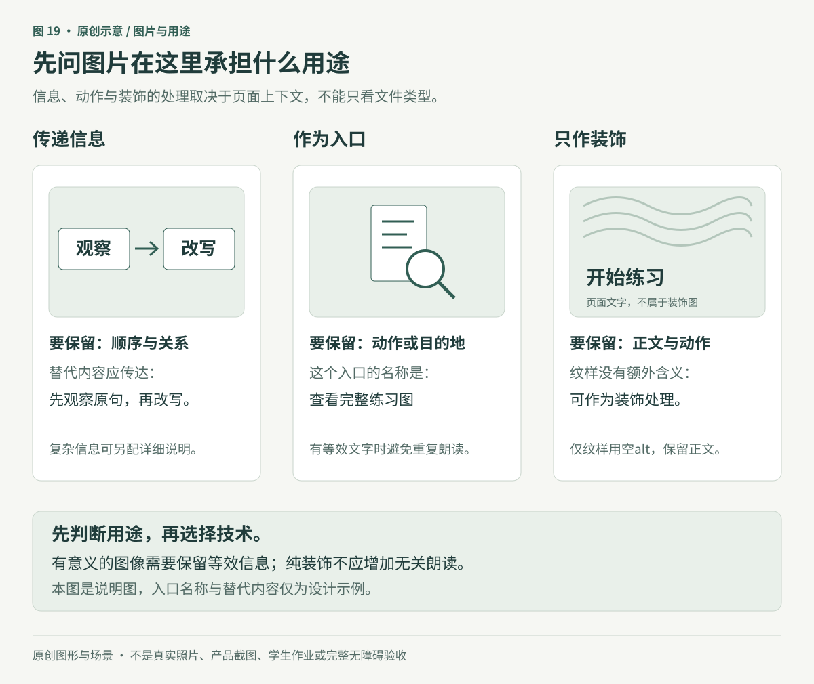
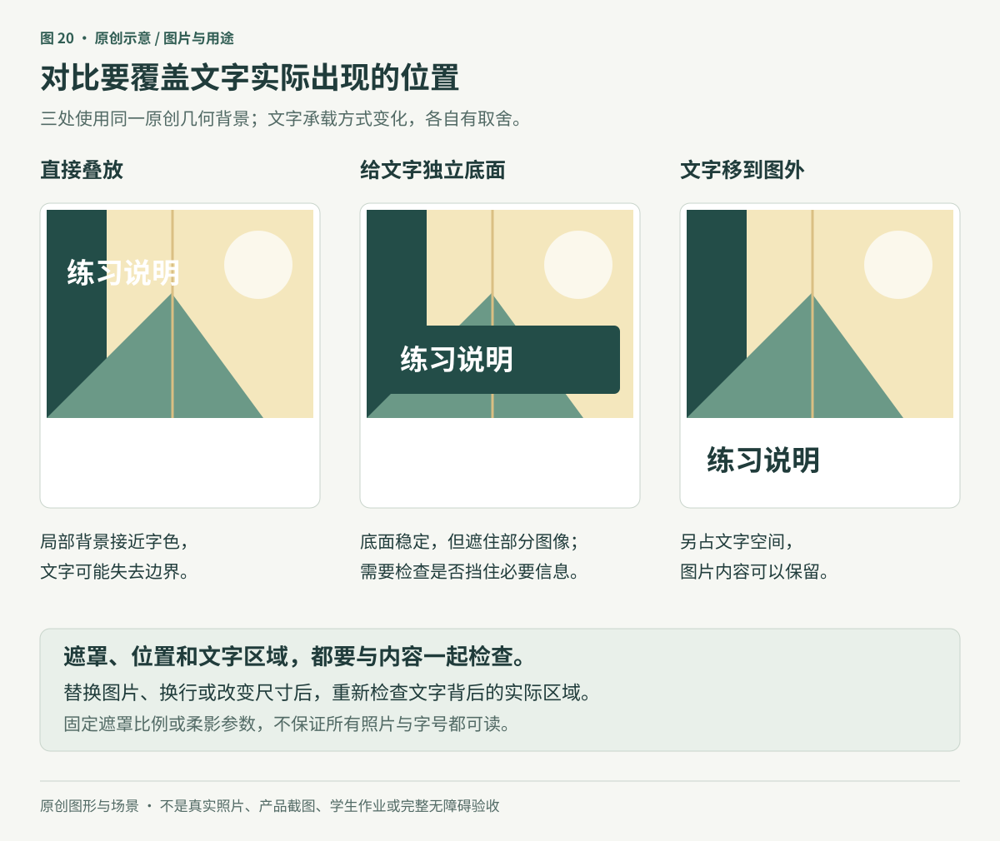
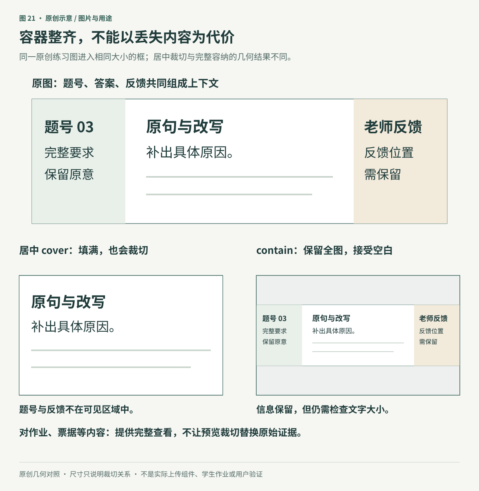

> 以下为上一版完整专题，保留当时的阅读范围和证据说明；有关是否发布课程原图的描述仅适用于上一版。

# 图片与用途：保留要传达的内容

**原创专题初稿。** 本章完整读取 Refactoring UI「Working with Images」四个整理页面的导出正文，以及主审读者在原生 Notion 页面所做的24次图片引用观察记录。本文作者没有独立重看源图，素材URL与文件哈希身份也尚未逐一核验。三张原创SVG以匿名练习页、抽象背景和作业图示解释方法，不使用课程原图，也不冒充真实照片、产品截图或学生作业。

老师在课程工作台里放入一张练习图。桌面上题目完整，到了窄屏，统一的横向缩略框裁掉了题号和右侧条件。卡片整齐了，学习者却少看了一部分要求。

图片设计的起点是：**使用者要从这张图理解、辨认或执行什么，哪些内容不能丢失。** 选材、对比、尺寸和裁切都应服务这个判断。画质精美、版面统一或加载成功，都不足以单独说明图片已经适合任务。

## 1. 先分清信息、动作与装饰

一张图可能承担几种不同职责。先写出当前页面需要它做什么，再决定呈现和替代信息。

| 图片用途 | 本章例子 | 设计时保留什么 |
|---|---|---|
| 传递信息 | 原句与改写步骤示意 | 理解任务所需的关系、条件和内容 |
| 提供证据 | 实际作品或操作截图 | 真实来源、必要上下文与可辨识细节 |
| 作为操作入口 | 查看完整练习图的图标 | 用户可理解的动作或目的地 |
| 补充氛围 | 练习页旁的抽象纹样 | 不抢占正文与动作；不承担唯一信息 |

同一素材在不同位置可能有不同用途。比如真实作品图在案例页承担证据，缩成列表预览后主要支持辨认；这不意味着列表可以把唯一的关键条件裁掉而又不提供查看途径。

图19展示三种用途，不是可操作网页。对于网页的`img`，替代文本应围绕图在当前上下文中的作用：传递信息时提供等效内容，独立作为入口时说明动作或目的地；纯装饰或与附近文本完全重复时，可以使用空`alt`。空值是有意的语义选择，不等于省略该属性。复杂图示可能需要正文中的详细解释，不能把一段文件名当成完整替代。[W3C：图片替代文本决策树](https://www.w3.org/WAI/tutorials/images/decision-tree/)、[WHATWG：图片替代文本要求](https://html.spec.whatwg.org/multipage/images.html#alt)

这不是“把所有图都改成文字”的要求，也不能依据素材文件名自动判定用途。应核对页面上下文，避免读屏重复朗读附近已有说明；若图片本身包含重要条件，普通图注也未必已经完整替代它。

### 好照片首先要符合要说明的对象

选择照片时，可以分别检查对象是否真实对应、必要细节是否可见、构图是否适合容器，以及调整是否改变了要表达的事实。专业摄影、现有照片和素材图库都是可选路径，不能仅凭设备或来源判断合适与否。

课程住宿卡片的两张照片并非同一个房间只改变曝光，因此不能把对照效果归因于单一摄影参数。真实房源、商品或作品不能为了更漂亮而换成不对应的对象；用于抽象氛围的示意图则应保持其示意身份。图库访问权限也不自动等于当前用途的再发布许可，应按项目使用范围核对。

## 2. 文字要面对它实际覆盖的背景

图片不同位置可能有很大明暗差异。白字在暗部清楚，移到亮部就可能失去边界；统一把字改黑，也可能在另一处失败。判断应落到文字所在区域，而不是只看整张图片的平均亮度。

W3C关于图片背景的失败说明要求考虑文字后方与字色最接近的区域。对整图极值的快速检查若不能确认通过，还需检查各字后方的实际背景；不应因一处远离文字的亮点就直接判定所有文字失败。[W3C：F83图片背景与文字对比](https://www.w3.org/WAI/WCAG22/Techniques/failures/F83)

可以依任务尝试几种方式：

- 将文字移到独立区域，让图片保留完整视觉内容。
- 在文字所在处提供明确承载面，同时检查有没有遮住关键内容。
- 在适合调整的图片上使用遮罩或局部处理，再检查实际组合。
- 调整文字位置或构图，使正文避开重要细节与明暗剧变区域。

这些方式有不同代价。独立区域会占用空间；承载面可能遮图；调色可能改变照片中的真实颜色。颜色本身是任务证据时，例如作品配色评议，不应为了标题可读而把整个原作染成品牌色。

图20使用同一组原创几何背景，刻意保留左侧局部不足对比来说明问题；它不是摄影修图示范。中间方案遮住一部分背景，右侧方案增加文字区。具体选哪种，应检查图片是否包含不能遮挡的信息，再测量和查看文字的实际组合。

### 不照搬遮罩与编辑参数

课程55%黑色遮罩只是一个例子，不能保证每张照片、每个字号和每种裁切都通过。编辑软件里的“亮度+40、对比-70”也不是可直接粘贴的CSS参数。最后一图的“发光”在观察记录中实际是黑色40%、偏移为零、模糊50px的柔影，并非白光；其静态效果没有对比测量证据。

柔影或文字边缘可以影响对比，但仍需根据实际前景、周边和背景判断，不能以“已经加阴影”代替检查。相关文字阈值、字号条件及计算边界见[第五篇](../05-color-and-state.md)。图片上的正文还要检查换行后的新位置、文字放大和内容替换；一张静态海报的成功处理不能外推到所有动态取景背景。[W3C：文字对比解释](https://www.w3.org/WAI/WCAG22/Understanding/contrast-minimum.html)

## 3. 图像尺寸和任务细节要一起变化

一幅图能放进容器，不代表其中内容还能阅读。缩小整张软件截图时，最先失去的往往是文字和细控件；换成更高分辨率文件，也不能自动把物理呈现很小的字变大。

先问读者需要看见什么，再选择表现方式：

| 任务 | 可尝试的呈现 | 需要保留的边界 |
|---|---|---|
| 理解完整页面关系 | 宽度足够的真实全图，并允许查看细节 | 不假定缩略图中的每个字都能阅读 |
| 观察一个局部操作 | 局部截图加必要位置和状态说明 | 不裁掉会改变判断的上下文 |
| 查看窄屏真实布局 | 实际窄屏版本的截图 | 不把桌面图压扁当作适配结果 |
| 解释结构或概念 | 标明身份的原创简化示意 | 不冒充真实产品、功能完成或验收截图 |

课程中的“缩到70%”不是安全与失败的固定界线。需要根据输出尺寸、内容密度、字体、清晰度和观看条件检查。相反，也不能把“不要缩小截图”理解为任何截图都必须原始像素大小展示。

图标同样如此。矢量图可以避免一类位图放大的模糊，却不保证笔画比例、细节密度和视觉重量适合每个尺寸。可以调整图形、简化细节、选用针对该用途的版本，或让容器与图形采用不同尺寸；不要求每次缩放都重新绘制。图形看起来多大与可操作区域多大是两个问题，触控不能仅凭图标外廓验收。

网页资源选择还涉及屏幕密度、缩放、显示宽度和网络条件。HTML的`srcset`与`sizes`可提供不同尺寸候选；`picture`也能用于按呈现条件选择不同构图。资源选择与内容重排是两件事：更大的文件不会恢复已经被裁掉的语义，也不会把简化示意变成真实截图。本次只核相关标准文字，没有跨浏览器验证。[WHATWG：自适应图片](https://html.spec.whatwg.org/multipage/images.html#adaptive-images)

## 4. 统一容器之前，确定能不能裁

为列表设置一致比例，有助于比较和排列，但是否适用取决于内容。人物头像、场景照片、票据、公式页和作业截图，对裁切的容忍度并不相同。瀑布流或不同比例也可以是合理结构，不能仅因卡片底边不齐就判错。

对于具有原始宽高比的图片：

- `object-fit: cover`保持比例填满容器，比例不同时可能裁去内容。
- `object-fit: contain`保持比例让全图容纳在容器内，可能留下空白。
- `object-position`影响内容在框内的对齐位置，不能凭空恢复全部已裁内容。

这是CSS的呈现行为，不是“所有图片应该统一使用cover”的建议。规范中还包含其他取值，本章只讨论与这项取舍有关的部分。[W3C：CSS Images 3的object-fit和object-position](https://www.w3.org/TR/css-images-3/#the-object-fit)

图21让同一原创图示进入相同尺寸的框，按比例计算缩放与裁切。它说明的是一种确定几何条件下的结果，不代表所有图片都会裁掉同样位置。对于作业或凭据，通常应优先保证完整查看；若列表必须裁切，要提供清楚的完整图入口，并在用户确认前展示裁切结果。

有意义的内容不应仅为方便布局就全部改成CSS背景。网页中可以保留语义图像与合适的替代信息，再处理尺寸；纯装饰背景可以采用不同方式。技术选择应保留理解与操作所需的语义，而不是把某个图片属性当作全部无障碍处理。[W3C：图片用途决策](https://www.w3.org/WAI/tutorials/images/decision-tree/)

### 用户上传内容需要真实的异常样本

使用代表样本检查：极宽与极高、主体靠边、浅背景、低分辨率、旋转方向不同、长文字截图，以及加载失败。不要只用一张居中且漂亮的照片验收整个上传组件。

图片边缘与页面融在一起时，可以考虑细边、承载面或适度阴影。课程的1px黑色10%内影是一个示意值，不是所有主题、照片和设备的规则；内影还可能被实际图片层遮住，须查看真实渲染。边界更清楚也不证明图片里的信息可读。

如果任务依赖原图，保留原文件与可辨识的预览关系，不让自动裁切或调色悄悄替换证据。能够返回原图、确认裁切、查看失败原因，比把所有输入强行变成同一外观更有用。

## 5. 把方法用于一次课程图片提交

以下是原创流程与待执行的验证计划，没有真实用户或学习效果数据。

任务为“提交一张带原句、改写与老师反馈位置的练习图”。先决定三个必需信息区，再设计上传后的完整预览。列表缩略图可以帮助辨认，但提交确认处必须允许检查全图；用户应知道当前显示是否发生裁切。

标题、上传状态和操作说明放在稳定的文字区域。若图片用于比较笔记内容，就保持原图颜色和细节；可读性问题通过查看方式处理，不默认改变证据。准备过程中保留原文件和处理记录，避免用户重新提交同一内容或额外维护台账。

然后检查图片不显示或无法被视觉读取时，任务是否仍有合适的信息途径。普通信息图片应提供相应用途的替代内容；复杂练习可能需要额外说明。若某项测试确实会因为完整文字替代而失去效度，WCAG 1.1.1为此规定了至少描述性标识的条件；不能因此给所有课程图片都留空，也不能把直接泄露答案当作合适替代。[WCAG 1.1.1](https://www.w3.org/TR/WCAG22/#non-text-content)、[相关解释](https://www.w3.org/WAI/WCAG22/Understanding/non-text-content.html)

课程设计者仍需判断被测的是知识理解、图形辨认还是视觉细节观察，并安排相应的可访问练习。这是教学决策，单靠一个`alt`字段不会自动解决。界面上传成功也不证明学生已经能独立解释原句为什么需要修改。

## 6. 验收图片有没有完成它的用途

| 层次 | 具体检查 | 失败信号 |
|---|---|---|
| 对象与证据 | 图片是否对应被描述的人、作品或场景 | 用不相符素材代替真实对象；示意图被说成实拍 |
| 信息完整性 | 题号、条件、主体与必要上下文能否获得 | 容器整齐，但关键内容被裁掉或遮住 |
| 阅读 | 在实际尺寸、换行、放大和替换图后读正文 | 局部文字融入背景；截图细字只能猜 |
| 语义与替代 | 按页面上下文核对信息、动作与装饰 | 文件名代替意义；入口无名称；装饰重复朗读 |
| 适配与加载 | 宽窄屏、不同密度、慢加载和失败 | 资源变清楚但布局仍不可用；错误状态没有下一步 |
| 操作 | 上传、查看全图、确认裁切、重试 | 原图丢失；预览与实际提交内容不一致 |
| 学习 | 不看示范解释或完成相近新任务 | 上传成功被当作理解成功 |

三张原创SVG已实际渲染检查中文、完整边界和图文关系。示意裁切采用明确几何比例，但并未实现网页上传组件；没有完成浏览器资源选择、键盘、触控、读屏、真实设备或学习效果验收。后续应在实际组件中保留代表样本和失败记录，避免只凭一张漂亮预览就宣布完成。

## 来源与证据范围

本章四个英文标题已对照[Refactoring UI官网目录](https://refactoringui.com/)；原作作者与著作身份见[主来源登记](../../sources/refactoring-ui.json)。整理者身份、原书版次、出版PDF逐页校勘及素材身份尚未核实。章节作者完整读正文并采用主审读者书面观察，没有独立重看课程源图。

| 来源ID | 整理页标题 | 采用与修正 | 原页图像观察 |
|---|---|---|---:|
| RUI-IMAGES-01 | Use good photos | 图片要符合任务与对象；两房间对照不是单一曝光实验，手机照片不被一概否定 | 1次 |
| RUI-IMAGES-02 | Text needs consistent contrast | 检查局部背景；遮罩比例、编辑参数和黑色柔影都不作为普适保证 | 6次 |
| RUI-IMAGES-03 | Everything has an intended size | 区分清晰度、细节密度和真实显示尺寸；简化UI必须标示意，缩放倍率不是硬规则 | 11次 |
| RUI-IMAGES-04 | Beware user-uploaded content | 容器与裁切按内容选择；保留图像语义，内影参数需要实际主题与图层检查 | 6次 |

匿名练习流程、用途表、图中抽象背景、裁切示例与验证方法是本章原创组织。官方技术补证只覆盖文中所列范围；CSS Images 3读取的是2023-12-18候选推荐草案，WHATWG为2026-10-26可见更新的Living Standard，WAI决策树和Understanding属于说明资料。它们不证明当前示意已经完成实现或全部合规。

详见[专题来源登记](../../sources/images-with-purpose.json)及[图示登记](../../assets/diagrams/register.json)。24次图片引用观察不等于24个独立素材；本进阶篇使用自制示意，[图文入门版](../07-images-with-purpose.md)另按用户确认的授权展示课程图并标注来源。这不能证明19个资料区的全部媒体已经审完。
