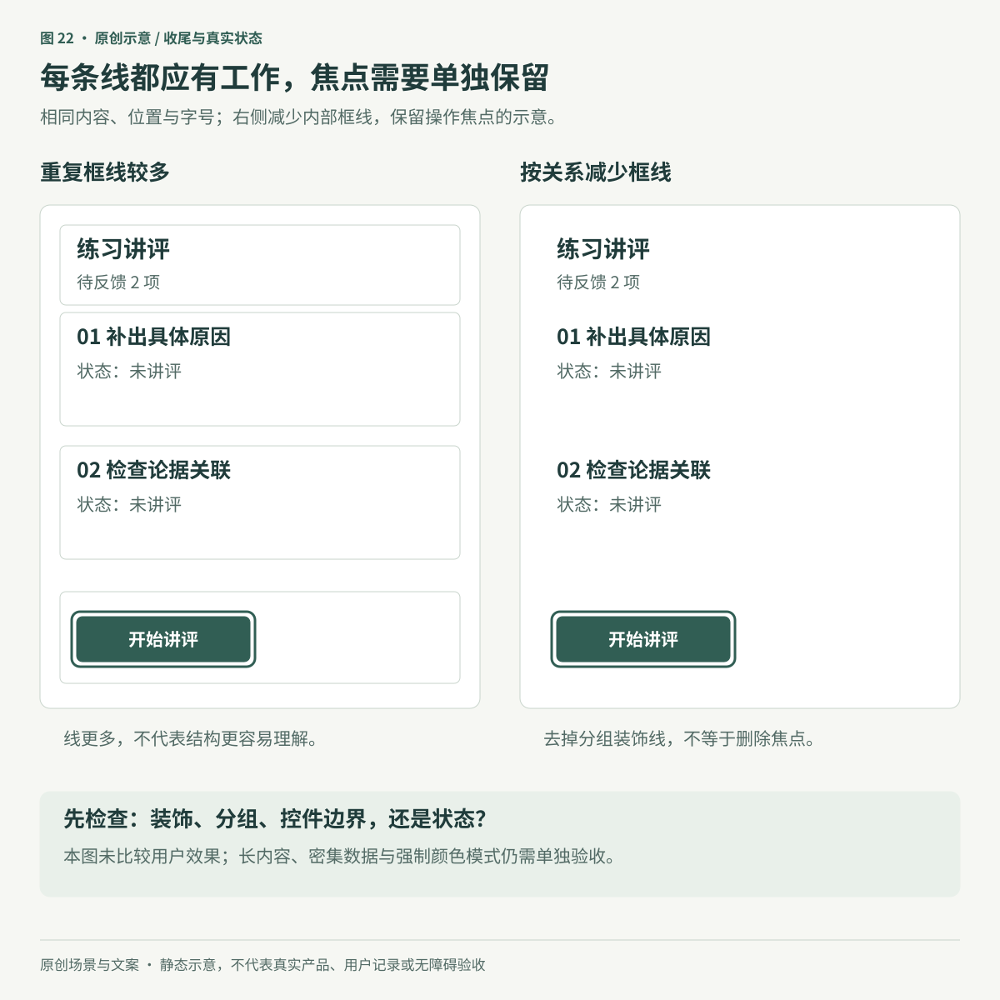
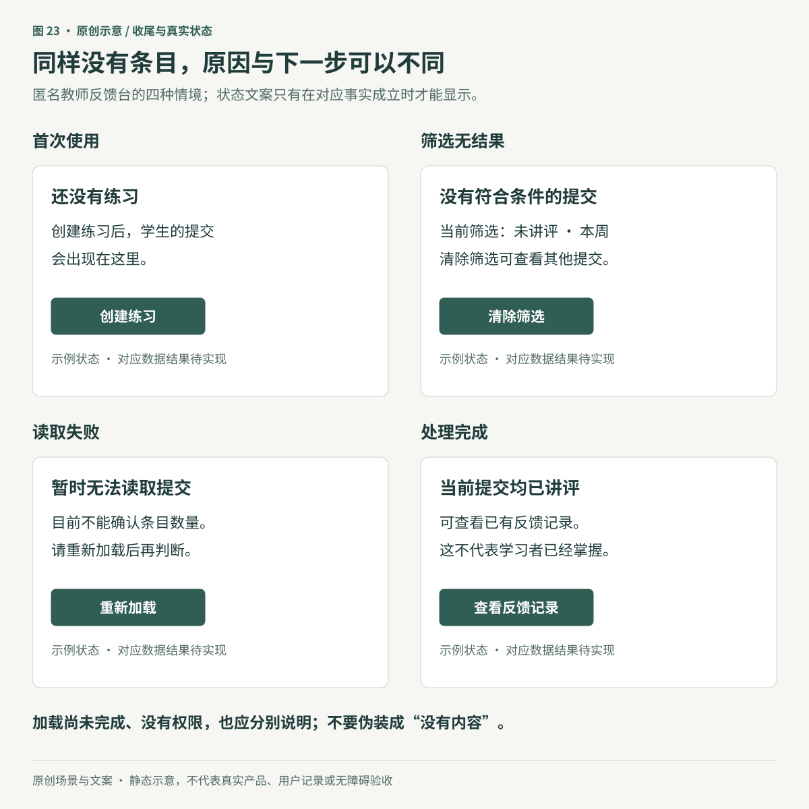
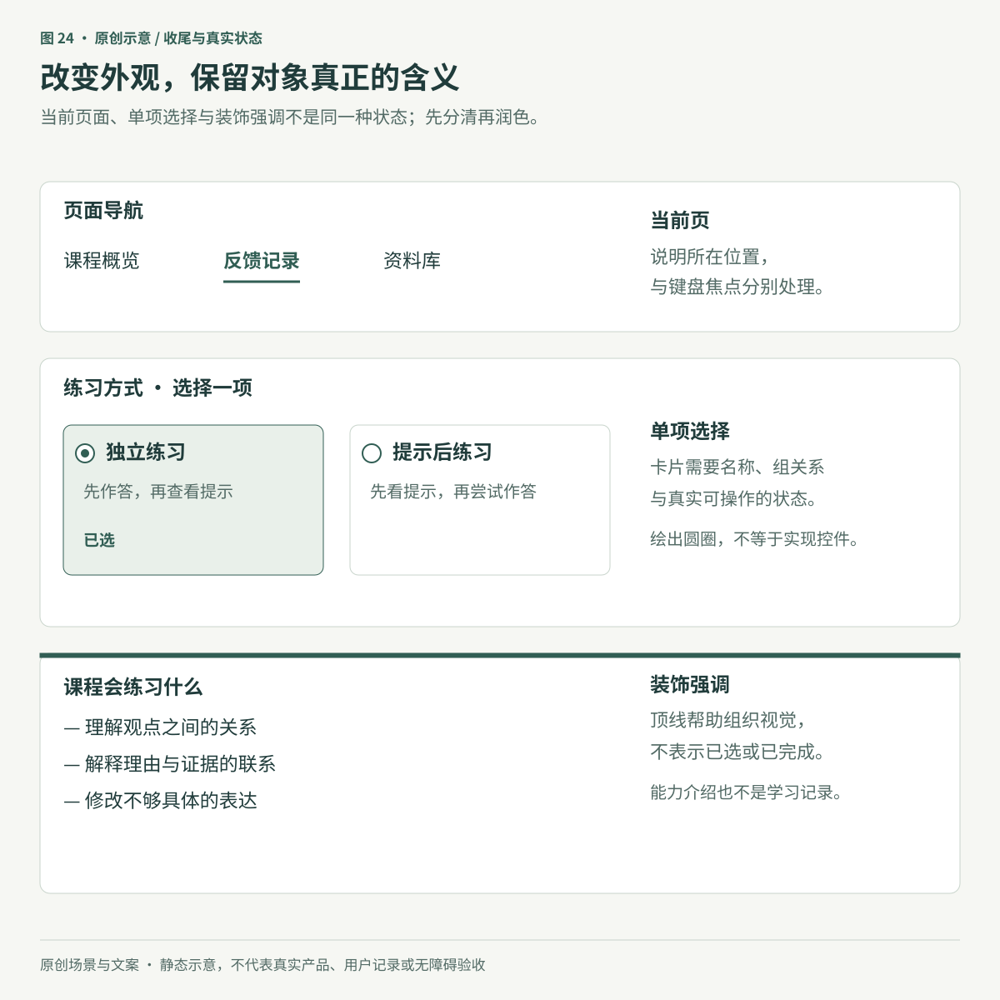

> 以下为上一版完整专题，保留当时的阅读范围和证据说明；有关是否发布课程原图的描述仅适用于上一版。

# 让细节说真话：收尾与真实状态

**原创专题初稿。** 本章完整读取了 Refactoring UI「Finishing Touches」六个整理页的导出正文，并使用主审读者在原生 Notion 页面中留下的32次图片引用观察记录。本文作者未亲自重新查看源图；原页上下文观察与素材URL、文件哈希身份核验是两件事。图22–24是新编的匿名教学工作台示意，不使用课程原图，也不是可运行产品。

教师打开反馈台，列表暂时没有内容。界面可以画一张插图，写一句“太棒了，全部完成”；但如果实际原因是读取失败，这份精致会传达错误事实。另一种问题更隐蔽：课程能力介绍前的一排勾，被看成学生已经完成的记录。

收尾阶段仍然需要产品判断。先确认界面知道什么、还不知道什么，再决定用边界、颜色、图标和文字表达。装饰可以建立气质，状态必须有依据；两者用同一套视觉语言时，尤其要防止含义串位。

## 1. 先给每个细节分配职责

一条线、一块底色、一个图标，可能承担不同的工作。修改前先说清它为什么存在：

| 视觉细节 | 它可能在说明什么 | 收尾时要保留的关系 |
|---|---|---|
| 课程介绍上方的彩线 | 页面气质、段落开端 | 不暗示课程已选中或已完成 |
| 导航文字下的短线 | 当前所在页面 | 与键盘焦点分开；有程序可识别的当前位置 |
| 输入区域的轮廓 | 哪一块可以输入 | 弱化后仍能辨认可操作区域 |
| 按钮周围的焦点指示 | 现在按键会作用于哪里 | 随焦点移动，并在适用环境中保持可见 |
| 列表中的分隔线 | 行、组或字段的对应关系 | 删除后仍能追踪内容，不发生错读 |
| 提示旁的图标与文字 | 发生了什么、接下来怎么办 | 图标、文字和真实状态保持一致 |

这不是要求一件装饰只能有一种作用，而是要求其含义可以解释。例如，提醒旁的彩线可以增加辨识度，但“保存失败”仍要由明确文字与实际结果支撑。课程价格卡上的顶线也不天然表示“推荐方案”；若确有推荐，应该另行说明推荐依据。

同样，锁形图标不能证明安全性，人物引言不能代替真实出处，装饰地图不能冒充服务覆盖数据。把项目符号换成勾之前，要判断读者会把它理解为“这项能力包含在课程中”，还是“我已经完成这项任务”。没有证据支持后一种解释时，普通项目符号往往更清楚。

## 2. 减少边框，是减少重复解释

边框能划定范围，也会让每一块都像独立容器。一个标题、两项任务和一个按钮，如果分别套框，读者可能要反复确认它们是否属于同一件事。可以先借助标题、对齐和[组内与组间距离](../03-space-and-density.md)表达关系，再判断哪些线还有必要。

图22控制了内容、位置与字号，便于观察内部框线本身的变化。右侧并未把所有边界删光，按钮焦点也单独保留。这是视觉关系示例，没有做使用者比较实验；长内容、密集数据或层次不清的场景，可能仍需要分隔。

可按下面的顺序尝试，而不是一次给全站去边框：

1. 找出重复描绘同一层级的线，先在一个代表区块里减少。
2. 观察标题、对齐和邻近关系能否承担分组；不要为了替代一条细线而无差别加大所有间距。
3. 只有在需要区域区分或临时层关系时，再采用表面色或阴影。
4. 保留识别控件、状态和数据关系所必需的表达，并检查键盘焦点。

所读课程示例依次变化了外框、搜索与页脚底色、行间分隔；并非一步消除全部边框。其阴影和行间距数值只是那个构图的参数，不是工作台默认值。密集表格中有助于追踪行列的线，也不能仅因为“更简洁”就删除。

WCAG 1.4.11（AA）关注识别控件、状态及理解图形所必需的视觉信息；适用时要求与相邻颜色至少3:1，并有停用控件及未改动用户代理外观等例外。不是每条装饰线都必须达到这个比值，也不是把一条必要线变淡到几乎不可见就算减少噪声。[W3C：Non-text Contrast](https://www.w3.org/WAI/WCAG22/Understanding/non-text-contrast.html)

阴影也不是边框的通用替代。所读 CSS Color Adjustment 候选推荐快照规定，强制颜色模式下、采用 `forced-color-adjust: auto` 时，`box-shadow` 和 `text-shadow` 会计算为 `none`。必要的边界或焦点要有在目标环境中仍可用的表达，并实际检查；不要为保留装饰一概阻止用户颜色调整。焦点的更多边界见[深度与临时层](../06-depth-and-layers.md)。[W3C：强制颜色模式](https://www.w3.org/TR/css-color-adjust-1/#forced-colors-properties)

## 3. 没有条目，先说明为什么

空状态是系统对当前情况的解释。首次没有数据、筛选后没有结果、请求失败和当前工作已处理完，都可能画成一个空列表；它们需要的文字和下一步却不一样。

Carbon 的空状态指南区分首次使用、用户操作导致无结果或工作完成、错误与权限等情况，并把图像和行动入口视为按情境选择的组成部分。小范围的无数据提示可以只有文字；并非每处都需要一幅大插图或一个创建按钮。[IBM Carbon：Empty states](https://www.carbondesignsystem.com/building-blocks/core/patterns/empty-states)

图23中的四个状态是独立场景，不能根据“数组长度为零”直接任选一个展示。实现时至少需要能区分请求是否完成、当前筛选条件、可访问范围，以及确实收到的数据结果。

| 情况 | 可以说明的事实 | 合理的下一步 | 容易造成的误导 |
|---|---|---|---|
| 首次尚无内容 | 已确认此范围还未创建内容 | 有创建权限且符合任务时，引导创建 | 把无权限或读取失败当成新用户 |
| 筛选或搜索无结果 | 当前条件未匹配到内容 | 修改条件、清除筛选、返回更大范围 | 把筛选控件全部隐藏，无法恢复 |
| 读取失败 | 目前无法确认结果 | 重试；必要时提供具体帮助 | 用“没有内容”或“全部完成”盖过错误 |
| 当前工作已处理完 | 已核实此范围内没有待处理项 | 查看记录、回到下一项任务 | 把处理完成写成学习掌握或全局完成 |
| 正在加载 | 结果尚未返回 | 说明正在获取；按实际需要提供取消 | 提前显示零条或成功状态 |
| 没有权限 | 当前访问被限制 | 说明可执行的申请或返回路径 | 承诺不存在的申请功能，或暴露不应显示的内容 |

“隐藏无用控件”要结合原因判断。首次还没有任何可筛选的对象时，过滤入口可能暂时没有帮助；由筛选造成空结果时，清除筛选却是最重要的恢复路径。若页面同时有两个完全相同的创建入口，可以减少重复；若它们分别属于不同对象或不同任务，不能只凭外观相似合并。

空状态也应保持证据范围。只查看了“本周、当前课程”，就不要写“你已完成全部工作”。保存失败时，只有实现确实保留了草稿，才能告诉用户“内容已保留”。图中的“当前提交均已讲评”更不表示学生已经学会；教学效果仍需后续独立作答等证据。

对于不改变上下文的动态结果提示，例如搜索后出现“没有结果”，WCAG 4.1.3（AA）要求适用的状态消息可通过角色或属性被辅助技术识别，无需让它获得焦点。不是所有新增内容都属于这类消息，也不应把每次更新都设为打断式警报；应按消息性质实现和测试。[W3C：Status Messages](https://www.w3.org/WAI/WCAG22/Understanding/status-messages.html)

## 4. 外观可以改变，对象含义要持续成立

视觉上变得丰富，并不要求重新发明控件。可以把原生单选项组织为较大的选项卡片，让名称、说明和选中状态更容易比较；但卡片仍然是一组互斥选择，不是几个碰巧画着圆圈的容器。

图24刻意把三种常被混用的表达放在一起：当前页面、单项选择和装饰强调。当前页面可以在键盘焦点离开导航后仍保持标记；选择也不会因为焦点移到别处就自动取消。若用 `aria-current` 说明当前位置，应按实际对象选值；它不替代标签页等组件中的 `aria-selected`。[W3C：aria-current](https://www.w3.org/TR/wai-aria-1.2/#aria-current)

### 单选卡片：保留名称、组关系与操作

实现时优先考虑原生表单控件与关联标签，按需要用 `fieldset` 和 `legend` 表达组关系。标签既说明用途，也可扩大可点击范围；视觉上有标题，不等于它已经与输入控件关联。[W3C：Labeling Controls](https://www.w3.org/WAI/tutorials/forms/labels/)、[Grouping Controls](https://www.w3.org/WAI/tutorials/forms/grouping/)

自定义单选组还需实现相应键盘行为。W3C APG 对普通单选组描述了进出组、空格选择、方向键移动并选择等操作；工具栏内的单选组有不同处理，原生浏览器也有特定初始焦点差异。不能只照一个静态示意就宣布全部情境都实现了。给普通元素添加角色，并不会自动附带完整行为。[W3C：Radio Group Pattern](https://www.w3.org/WAI/ARIA/apg/patterns/radio/)、[Read Me First](https://www.w3.org/WAI/ARIA/apg/practices/read-me-first/)

### 导航展开区：更丰富不等于更有用

链接配图标、描述和分栏，适合需要帮助区分的内容；只有几个明确目的地时，简单链接也可以充分完成任务。增加视觉内容后，应重新检查窄屏、阅读顺序、键盘访问和展开关闭，不能把更宽的菜单本身当成改进证据。

日常所说的“导航菜单”也不自动需要 ARIA 的 `menu` 角色。W3C 的 Disclosure Navigation 示例明确区分普通站点导航与复杂菜单组件；它同时提醒示例并非未经验证即可用于生产的成品。本章只读取其说明，未操作示例。[W3C：Disclosure Navigation](https://www.w3.org/WAI/ARIA/apg/patterns/disclosure/examples/disclosure-navigation/)

### 表格合并：检查读者还要做什么

把姓名与角色放在同一个单元格，可能减少横向跳读；如果使用者需要分别按角色排序、比较或筛选，就必须保留这些能力及清楚的结构。不能根据示例“六列变四列”推出列越少越好。缩减列数也不会免除表头与数据关系的标记要求；读者仍要知道每个值属于哪一项。[W3C：Tables Tutorial](https://www.w3.org/WAI/tutorials/tables/)

## 5. 装饰背景时，仍以真实内容为前景

背景色、温和渐变或少量纹样可以区分章节、建立课程气质。它们不应让文本难读，也不应让普通内容看起来像一份数据图。世界地图、点阵和波形若只是装饰，就不附带真实覆盖范围、采样结果或活动记录的含义。

不要只看无字背景。把长中文标题、链接、按钮和可能出现的错误提示一起放进去，检查它们实际叠加处的可读性。相近色相不保证渐变全程对比足够，降低图案透明度也不保证文字区域处处清楚；相关方法见[文字与阅读](../04-text-for-reading.md)、[颜色与状态](../05-color-and-state.md)和[图像用途](../07-images-with-purpose.md)。

装饰可以只出现在适合停留的介绍区域，密集操作区则保持稳定。交替背景并非每个区块的必选模板；它若把连续任务切成几个看似无关的板块，便损害了原先的联系。反过来，所有区域完全相同也不必然简洁，要看读者是否能找到当前任务与下一步。

## 6. 用一次真实流程完成收尾

在匿名反馈台中，可以用“查找待讲评提交、处理一项、返回列表”作为代表流程。收尾前先把事实写清：数据从哪里来、当前筛选是什么、何时算处理成功、失败后还有什么可恢复。

然后对同一流程检查首次无内容、有内容、筛选无结果、加载、失败及处理后的适用状态。每种状态都应给出有依据的解释，入口应通向真正存在的操作。只实现了静态图时，把它保留为示意，不伪装成已经完成的提交、保存或分析。

最后检查细节是否帮助任务：有无重复框线与重复入口，装饰是否被误认成状态，名称和组关系是否仍然清楚，窄屏和文字放大后是否仍可操作。键盘、目标辅助技术及适用颜色设置要在真正的实现中验证。静态图能揭示文案与空间关系，不能证明这些行为。

教学与创作产品尤其要守住结果边界。教师“已经发送反馈”、学习者“已经看过反馈”和“能独立迁移运用”是不同事件。界面可以帮助保存提交、反馈和后续尝试的证据，不能靠一个绿色勾把它们压成同一种成功。减少维护负担的办法，是让真实操作留下适当记录，而不是要求使用者再次手工维护一份完成清单。

## 来源与审读范围

六页是二手课程整理，整理者身份未核实。主审读者于2026-10-30从标题至页尾分屏观察32次图片引用；本文作者读取其书面记录，未独立重看源图。六个英文标题已与[Refactoring UI 官方目录](https://refactoringui.com/)核对，但未逐页对照付费出版物或版次；原作归属见[原作登记](../../sources/refactoring-ui.json)。

| 来源ID | 整理页 | 使用与必要限定 | 图片引用观察 |
|---|---|---|---:|
| RUI-FINISH-01 | Supercharge the defaults | 默认细节可精修；勾、锁与引言不构成完成、安全或真实推荐证据，自定义外观需保留语义行为 | 5次 |
| RUI-FINISH-02 | Add color with accent borders | 彩线可以强调或分组；装饰、当前位置、选择与焦点分别处理 | 4次 |
| RUI-FINISH-03 | Decorate your backgrounds | 背景服务内容；渐变、透明度与纹样不能替代局部对比检查，地图不自动是数据 | 8次 |
| RUI-FINISH-04 | Don’t overlook empty states | 按实际原因解释空状态；首次使用、筛选、失败等不可混同，恢复入口不能误删 | 4次 |
| RUI-FINISH-05 | Use fewer borders | 减少冗余分隔；不机械复制阴影或间距，不删除焦点、必要边界与数据关系 | 4次 |
| RUI-FINISH-06 | Think outside the box | 按任务调整菜单、表格与选项外观；简单样式仍可有效，排序需求与单选语义必须保留 | 7次 |

职责分类、四种空状态的匿名教学场景、三张图及验证流程是本章的原创组织。官方补证只读取所引文字段落、规则与示例说明；未观看官方媒体或操作交互示例。Carbon 是特定设计系统的指南，APG 是模式说明，WCAG 的等级与适用条件另行保留，不把它们合并成一张已通过的产品验收单。

三张SVG已实际渲染并逐张检查文字、范围和图文对应。它们没有实现控件、网络、存储或辅助技术行为。32次引用不等于32份独立素材，本章也不表示19个资料区的媒体全部补读完成。详细范围见[专题来源登记](../../sources/finish-and-real-states.json)与[图示登记](../../assets/diagrams/register.json)。
