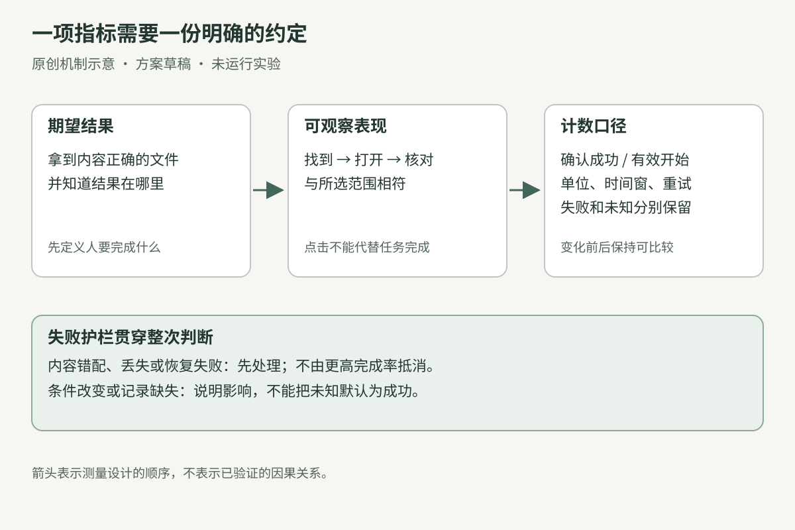
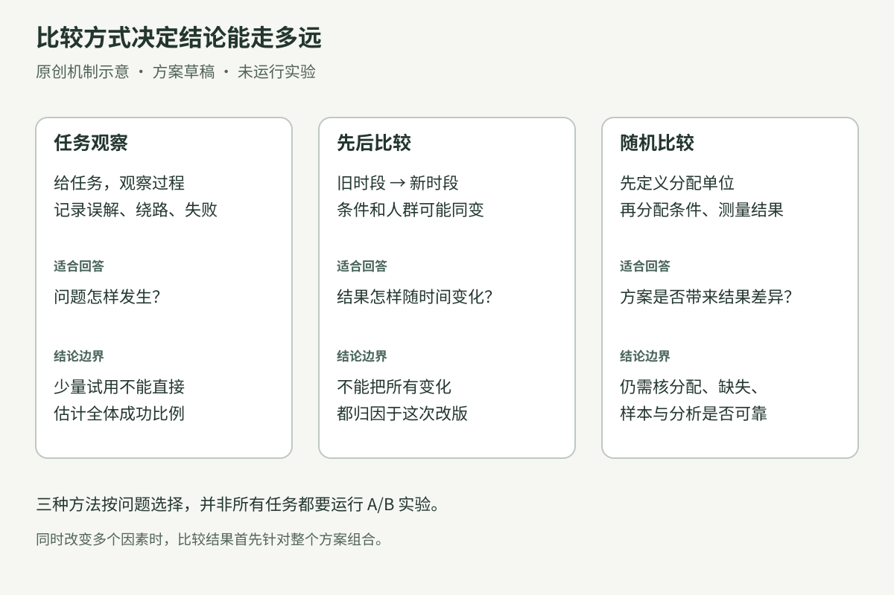
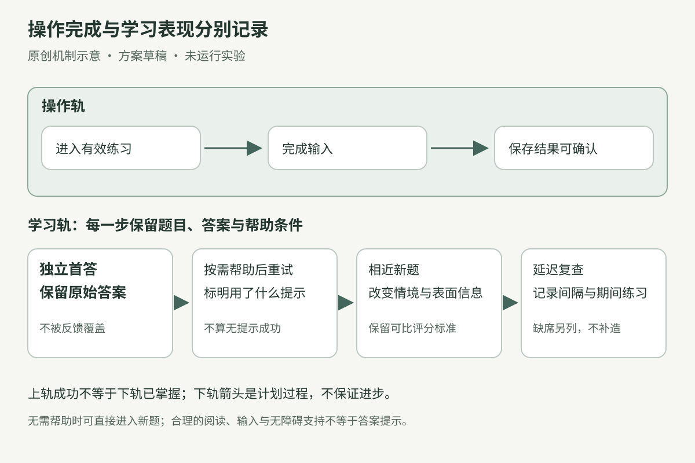

> 以下为上一版完整专题，保留当时的阅读范围和证据说明；有关是否发布课程原图的描述仅适用于上一版。

# 指标、实验与学习效果

**原创专题初稿。** 本章受本地《UX Metrics and ROI》PDF 的附件阅读启发，并核验六项公开来源的指定文字范围。本文作者逐页读取并实际查看该本地副本的物理页 101–200，保留嵌入截图微字的可读性限制；副本来源尚未认证，不等同官方原始版或当前线上附件已核，也不是全书审读声明。图25–27、两个贯穿案例与计算例子均为本章新编，没有实际招募用户、运行产品实验或测得学习收益。正文和三张图已由另一编稿者独立通读、实际查看；图仍是机制示意，不能当成已上线界面或实验结果。

一个练习工具改版后，提交率提高了，平均作答时间也缩短了。团队可能据此判断“更好用，也更容易学会”。但如果新版在学生动笔前就展开完整答案，这两项数字可能同时变好，学生独立组织答案的能力却仍然未知。

另一个工具把“导出”按钮变得更醒目，点击次数增加了。若文件没有写入成功，或者用户找不到结果，这个数字也没有回答导出任务是否完成。

本章帮助你把一句“这次改动有效吗”拆成可回答的问题：希望谁做到什么，什么表现算完成，怎样计算，可能伤害什么，以及现有证据允许说到哪一步。它适用于软件流程、工作台和学习活动的改进，不提供一套可以直接套用所有业务的指标榜单，也不替代正式实验的统计设计。

## 1. 先写要判断的结果，再选数字

指标是经过定义的观察结果。它的价值来自与任务的关系，不来自数字看起来精确。

先把目标写成一个人在具体条件下能做到的事。例如，“提高导出按钮点击率”已经预先选定了一个动作；“让使用者得到一份内容正确、可重新打开的导出文件”才说明了需要实现的结果。点击可以帮助发现入口是否被注意到，但不能单独代表文件已取得。

Google Research 发布的 Rodden、Hutchinson 与 Fu 的论文介绍了从产品目标映射到指标的思路。本章据此进一步使用下面的操作表，将结果、观察方式和判定限制一起写出；这张表是原创整理，并非该论文原表的翻译。[论文出版页与摘要](https://research.google/pubs/measuring-the-user-experience-on-a-large-scale-user-centered-metrics-for-web-applications/)

| 层次 | 导出工具 | 因果表达练习 |
|---|---|---|
| 期望结果 | 使用者拿到正确文件，并知道它在哪里 | 学习者在新题中独立表达正确因果关系 |
| 可观察表现 | 文件可找到、可打开、内容与所选范围相符 | 没有答案提示时，句子保留因果方向并符合目标表达 |
| 记录方式 | 文件保存结果、内容检查、一次实际查找任务 | 首答原文、帮助条件、评分依据和后续新题 |
| 可汇总指标 | 成功取得正确文件的任务比例 | 指定条件下达到评分标准的人数与比例 |
| 仍不能直接证明 | 所有平台、所有文件类型都可靠 | 所有语境都掌握、长期保持或整个英语能力提高 |

图25 从左至右说明一项指标需要怎样被限定。下面的护栏表示：即使主指标上升，丢内容、产生错误结果或破坏必要学习活动，也会改变是否采用方案的决定。箭头表示设计测量的步骤，不表示已经证明的因果链。

有些数字能较快获得，却只间接接近目标，因而被用作代理指标。开始练习、使用次数、停留时长和满意度可以回答各自的问题；只有在目标明确、关系有证据支持的条件下，才适合进一步代表某种结果。不要把几个代理指标加成一个看似完整的“学会指数”。

同一数字的方向也依赖任务。找一个已经确定的文件时，较短用时可能有益；理解一个新概念时，用时变短可能来自熟练，也可能来自跳过思考。先检查过程和结果，才知道速度意味着什么。

## 2. 每项指标都要带着口径

“完成率 75%”缺少分母、时间和成功条件时，几乎无法比较。至少应保留这些内容：

| 要写清什么 | 具体问题 |
|---|---|
| 人与任务 | 哪类使用者、哪个版本、哪一种任务？ |
| 成功条件 | 到达某页面、产生文件、文件内容正确，还是能独立完成？ |
| 分子与分母 | 数的是人、任务、文件还是点击？重试算不算新任务？ |
| 时间窗 | 从什么事件开始，到什么事件结束？观察持续多久？ |
| 失败与未知 | 放弃、超时、缺记录、未参加复查分别怎么处理？ |
| 帮助与条件 | 是否有提示、范例、辅助技术、教师或 AI？ |
| 决策边界 | 多大改善才值得改动？什么失败会让方案停止？ |

这些定义最好在看到结果前写下。发生有理由的变更时，保留变更及影响，不把旧数据悄悄按新规则重新命名。

分母尤其容易被无意改变。若新版只对顺利走到最后的人问满意度，就不能与旧版所有开始任务的人直接比较。只计算成功者的用时，也可能遮住更多人放弃的情况。成功用时可以单列，但要同时呈现成功、失败和仍未知的数量。

计算比例时，先保留原始计数，再写百分比。下面完全是算术示范，并非研究结果：

- 旧条件下 16 人中 8 人达到标准，即 50%；新条件下 16 人中 12 人达到标准，即 75%。
- 差值是 25 个百分点；相对增幅为（75% − 50%）÷ 50% = 50%。
- 这不能被写成“增加 50 个百分点”，也不能仅凭这组数证明改动造成了提升。
- 若一次相同任务的用时从 48 秒变为 36 秒，用时减少 25%。不要将其他形式的“改善分数”直接改写为时间下降比例。

这些算法也有边界：基线为零时，不能直接套用上述相对增长公式；取整后的摘要可能无法还原精确增幅。若来源正文、图表和摘要数值不一致，先核对单位、分母、时间窗与精度。仍解释不了时，记录冲突并排除有争议的数字，不为使故事顺畅而补造计算过程。

## 3. 软件例子：一次导出怎样算完成

以下是一个待实施的原创方案。工具允许使用者选择一组练习记录并导出文件。有人反馈“点过了，但不知道结果在哪里”。这只是问题线索；在观察前，不能确定原因是入口、保存过程还是结果提示。

### 先复现任务

准备内容已知的一组样例记录，分别覆盖正常数据、长中文、没有记录和保存失败。请目标使用者把指定记录导出，随后找到文件、打开，并确认内容范围。主持人不先解释按钮位置。

观察重点是哪里中断：没有发现入口、选错范围、误以为等待就是成功、找不到文件，还是文件内容有误。记录动作和原话，再写原因假设。若保存本身失败，换按钮颜色不是充分修复。

本例拟改动的是结果阶段：只有取得实际保存结果才显示成功；展示文件名与去向；失败时保留选择并支持重试。是否能直接打开文件，取决于平台真实能力。原生保存位置、浏览器下载目录和用户另选位置可能不同，界面不能给出未经确认的去向。

### 把测量口径落到任务

| 项目 | 本例预先约定的口径 |
|---|---|
| 观察单位 | 一位参与者完成一次指定导出任务；同任务内重试保留为重试，不新增分母 |
| 分母 | 已开始且任务材料有效的全部观察任务；用户放弃或操作超时保留在内 |
| 主结果 | 在观察窗内找到并打开文件，且与预定内容范围一致的任务数 ÷ 分母 |
| 时间窗 | 从读完任务并开始操作，到完成内容核对；本轮设五分钟上限，只是此测试的安排 |
| 辅助观察 | 首次找到入口用时、重试次数、求助及误解位置；不将它们替代主结果 |
| 失败护栏 | 导出内容缺失或错配、同一提交意外生成重复内容、失败后原选择丢失 |
| 数据缺失 | 设备记录中断另列“无法判定”，报告数量和原因，不当成功，也不悄悄删除 |

成功率分母仍包括无法判定的有效开始任务时，需同时给出其数量，并说明该比例是“已确认成功占全部有效开始”的保守描述；它不是把未知者认定为真实失败。也可以另列已完成观察任务的成功率，但两个口径不能混用。

上线后的事件记录应延用已明确的含义。一次“按钮点击”不能更名为“导出成功”；系统确认写入也不必然代表用户找到文件或内容符合意图。自动记录适合覆盖保存失败、重试与版本等事实，内容正确性和结果理解仍可能需要抽样核对与真人任务观察。

### 根据观察作决定

如果新方案让成功任务更快，却出现内容错配，就先修复正确性问题。若成功率看似上升，但许多失败记录因采集故障消失，则先修测量。若只是几次试用中少了明显误解，可以说“这轮未再观察到该误解”，并继续验证；不能直接宣布总体成功率提高多少。

这轮最小产物是一份带口径的任务记录、一段可复现的问题描述和一个决定。保存现有测试产生的结果即可，无需让使用者另填一份重复台账。

## 4. 先后变化、方案比较与实验回答不同问题

旧版在上个月，新版在这个月；两个月的数字不同，说明出现了变化。与此同时，使用者构成、网络、内容、工作量和熟悉程度都可能改变。把这类先后比较当作因果证据，会把其他变化也算到改版头上。Impact Canada 的方法指南将简单前后比较列为探索性方法，并说明其时间效应限制。[方法指南第 5.6 节](https://impact.canada.ca/en/reports/measuring-impact-by-design)

图26 没有把三种方法排成好坏等级。找出一处误解时，观察几个人的过程可能很有帮助；估计某项改动是否造成平均结果差异，则需要更强的比较设计。方法应随问题选择。

| 方式 | 能帮助回答什么 | 需要保留什么限制 |
|---|---|---|
| 观察一次真实任务 | 人在哪里误解、绕路或失败 | 不能用少量观察估计全体比例 |
| 同一人先旧后新 | 此人两次操作有什么变化 | 第二次可能受练习、记忆和顺序影响 |
| 两个时段的汇总比较 | 指标随版本和时间怎样变化 | 人群与环境可能一起变化 |
| 合理执行的随机比较 | 被分配方案的结果是否存在可归于方案的差异 | 分配、数据质量、缺失、样本与分析仍须检查 |

NIST 对完全随机设计的说明把处理条件随机分配到实验单位，而不是按固定顺序依次安排各条件。随机化帮助减少分配与其他因素的系统关联，但不保证有限样本两组恰好相同，也不能补救含义错误的指标。[NIST：Completely randomized designs](https://www.itl.nist.gov/div898/handbook/pri/section3/pri331.htm)

在软件中，先决定随机分配的单位。若同一人多次操作，每次点击都重新切版本，前一次体验可能影响后一次；应按需要采用稳定分配，并使用与设计相符的分析。学习活动中，学生会交流，班级和教师也会带来共同条件；按学生还是按班级分配，需要研究设计一起决定。两组存在本身不构成可靠实验。

正式比较前，应写清主要结果、其他诊断指标、护栏、分配方式、收集时长与结束规则。不要看见一次有利波动就停下，再倒推“早已计划如此”。本章不规定通用人数或天数；样本与分析方法取决于目标差异、波动、分配单位、重复观测等条件，需由具备相应能力的人核对。

一次随机比较即使执行正确，若同时改了文案、入口和保存逻辑，结果针对的是整个方案组合，不能自动拆成每个因素的独立贡献。统计判断也不直接替团队决定收益是否值得成本，或是否存在不可接受的错误。

## 5. 学习例子：会提交答案与会表达因果

本例目标是：学习者在已认识的词汇范围内，能独立把两句话合成一句正确的因果表达，并说明哪部分是原因、哪部分是结果。所用词汇和过去时视为已经教过；若这些前提不成立，应先调整材料，不能把词汇障碍直接判成因果理解失败。

它是一项原创短练习设计，尚无学生实际参加。它不声称代表完整英语水平，也不把某个固定复查间隔当成所有人的最佳安排。

### 第一次回答先保留

练习材料为：

> The road was flooded. The bus was delayed.

要求学习者使用 because 合成一句话，并指出原因和结果。一种可接受表达是：The bus was delayed because the road was flooded. 也可以接受因果和语法都成立的其他写法，不要求逐字匹配示例答案。

假设出现一条示范性错误：“The road was flooded because the bus was delayed.” 它包含关键词，却颠倒了关系。这个例子是本章编写的错误样例，不是真实学生记录。

系统先保存首答，再反馈“这句话把什么说成了原因”。学习者需要帮助时，可以先标注两事件的关系，再尝试重写；仍不能继续时，再给出句型或完整示范。实际用了哪种帮助，应与重试答案一起记录。看过完整答案后的正确重写有练习价值，但不能记成未提示独立完成。

IES/WWC 的学习指南支持分散复习、交替示范与解题，以及主动提取内容等做法；不同建议的证据等级并不相同。本章采用其一般方向，不将所有提示安排或本例英语题型冒称已有实验证明。[IES/WWC 指南及建议列表，2007](https://ies.ed.gov/ncee/wwc/PracticeGuide/1)

### 换题，才开始检查能否迁移

完成反馈后，可以换成已知词汇的新情境：

> Mina charged her phone. Its battery was almost empty.

新题改变表面情境和信息顺序，仍要求同一种因果判断。它检查的是邻近范围内的运用；不能据一次答对就推成能解释复杂历史事件、读懂所有因果论证或掌握所有连接词。

评分前写清标准：因果方向是否正确，是否保留两句话的核心信息，目标连接结构是否成立。若只有拼写小错，应记录其是否影响本轮目标，而不是事后为某组更宽松地改标准。由 AI 协助评分时，保留题目、答案、依据和人工复核位置；模型说“正确”本身不是已验证的评分质量。

图27 的上轨记录能否进入、作答和保存，下轨记录不同帮助与时间条件下的表现。帮助后重试按需安排，无需帮助时可直接进入新题。下轨各节点之间的箭头只表示计划过程，不保证每个人都会进步。保存两条轨道能避免把“已交练习”自动改成“已经掌握”。

### 加入延迟检查，并保留缺席者

下一次适合的课程安排中，使用难度与目标相近的未见材料，再看独立表现。本例可以先安排下周复查，这是教学日程选择，需要据实际课程调整。单次新题或单次延迟检查都有偶然性；结合多次表现、错误类型与后续学习过程，才能形成更稳妥的判断。

National Research Council 对迁移的讨论强调新问题中的运用、原有理解的程度和多情境学习，并提醒不要只凭一次迁移测试判断。它也区分时间投入与时间如何被使用。本章的分轨记录是对此的原创设计应用，不是该书已验证的产品流程。[How People Learn，结论章“Transfer of Learning”，2000](https://www.nationalacademies.org/read/9853/chapter/15)

| 要观察什么 | 本例口径 | 不应改写成什么 |
|---|---|---|
| 操作完成 | 进入有效练习后成功保存答案的任务数；同步列失败和未知 | 已学会因果表达的人数 |
| 独立首答 | 在约定无答案提示条件下，达到评分标准的人数 ÷ 实际完成该评估的人数 | 所有报名者都达到的水平 |
| 帮助后重试 | 按实际帮助类型分别记录答案、依据与是否改正 | 无帮助成功率 |
| 相近新题 | 未见情境、目标一致，记录独立与提示条件 | 跨所有学科与语境的迁移能力 |
| 延迟表现 | 记录实际间隔、期间练习和复查答案 | 排除了期间一切其他学习的教学净效果 |
| 观察覆盖 | 实际完成复查人数 ÷ 应参加复查人数，并列缺席及原因 | 将缺席者全部当作不会，或直接忽略 |

如果只剩表现较好的学生参加复查，即使复查正确率高，也不能直接推断整组改善。若要估计教学方式的影响，还需处理比较设计和缺失问题；上述记录先帮助教师看清已经观察到什么。

本例的护栏包括：首答不被系统覆盖；求助不被惩罚到使人不敢提问；评分错误可更正；辅助技术和合理便利不被误当作弊；个人答案只在必要范围内保留与使用。无提示评估是为了检查某项独立能力，不能成为取消必要阅读、输入或无障碍支持的理由。

## 6. 反例：把一个数字推好，却损害任务

**为了提高完成率，提前显示答案。** 学生更容易交作业，但独立表现的含义已经改变。可以保留示范和帮助，把帮助条件记录清楚，并另设适合目标的独立检查。

**为了缩短用时，隐藏检查内容。** 导出流程快了一步，用户却更容易选错范围。应同时看正确性、恢复和结果理解，而不是单独奖励速度。

**为了提高留存，不断打断使用者。** 回访次数上升不直接说明任务值得继续，也不证明学习提升。需要看回访中完成了什么，是否增加不必要负担，以及用户是否能自主控制提醒。

**为了呈现漂亮改善，只报告最好的指标。** 某项结果变好，另一项错误却增加，或者大量数据无法判定。完整报告应保留预先关注的结果和护栏，再解释取舍。NN/g 对 UX Metrics and ROI 的官方介绍也明确其案例包含正向、无明显收益和负向结果；案例存在不等于对未来改版作收益保证。[官方报告介绍](https://www.nngroup.com/reports/ux-metrics-roi/)

## 7. 留下一份能继续工作的判断

开始一轮改进时，可以按这个顺序推进：

1. 写一个具体结果，说明对象、条件和要完成的任务。
2. 选一项主要结果和必要的失败护栏，定义计数单位、分母、时间窗与未知值。
3. 检查记录是否真的对应这些定义；先复现成功、失败、重试和缺数据。
4. 按问题选择任务观察、描述性比较或正式实验，提前写清结论边界。
5. 在结果出现后，保留原始数量、条件与不利观察；再决定采用、修改、补证或停止。
6. 学习任务另存帮助条件、新题和后续表现，避免把操作成功或即时答案正确当成长期掌握。

一次诚实的结论可以这样写：“在本轮给定任务和设备条件下，观察到参与者能找到并打开正确文件；保存失败后的恢复仍有问题。接下来先修恢复，再扩大到其他文件类型。”它比“体验提升 50%”更容易指导下一步。

学习活动的结论也应具体：“已观察到部分学习者在无答案提示的新题中正确表达因果；其他人需要关系提示。下次在相近难度的新情境复查，并记录是否参加与期间练习。”这既保留进步证据，也给出下一次教学需要解决的问题。

本章的两个例子目前只有设计方案和可执行的观察安排。文件数、图示质量、公式检查及来源核验，都不能替代真实用户操作或学习效果证据。

## 来源与实际核验范围

核验日期：2026-10-30。以下均使用作者、出版机构或官方方法页面；只按列出的文字范围引用。网页中的图片、视频、音频和交互示例未观看或操作，未据此声称全文出版物已审。详细登记见[本章来源记录](../../sources/metrics-and-learning.json)。

| 来源 | 实际读取范围 | 本章采用范围 |
|---|---|---|
| Rodden、Hutchinson、Fu，CHI 2010，Google Research出版页 | 题名、作者、年份与摘要；未读下载论文全文 | 从产品目标映射到用户体验指标的一般思路 |
| NIST/SEMATECH，Completely randomized designs | 第5.3.3.1节网页文字 | 随机分配与固定顺序有别；不代替具体实验设计 |
| 加拿大枢密院 Impact and Innovation Unit，2019 | 第5.1与5.6节相关文字及方法限制 | 随机比较和简单前后比较的因果边界 |
| IES/WWC，Organizing Instruction and Study to Improve Student Learning，2007 | 官方建议列表、简要解释、证据等级与作者名单 | 分散练习、示范与解题、主动提取的一般方向；未系统重审原始研究 |
| National Research Council，How People Learn扩展版，2000 | 结论章Transfer of Learning节的网页文字 | 多情境运用、原有理解和一次迁移检查的限制；不称最新系统综述 |
| Nielsen Norman Group，UX Metrics and ROI，第5版官方介绍 | 书名、版次、范围及存在正/中性/负向案例的描述 | 说明改善结果需要实际观察；不引用未能核对的案例数字 |

本章不复刻来源案例的增长数值或图像，也不把课堂参与度、网站转化或界面偏好当成学习科学结论。已完成另一编稿者的正文和三张渲染图独立复核；未第二次逐条重开全部公开来源。正式发布时仍需检查文件版本与线上呈现，真实产品和学习效果须另行验证。
